# Replication and clinical-model report: machine-learning prediction of 1-year mortality in patients with diabetic neuropathy (DN), MIMIC-IV v3.1

Original paper: Huang Y, Mo W, et al. *Machine learning models predict mortality risk in diabetic neuropathy patients using MIMIC-IV data.* Sci Rep 2025;15:38702.

This report is generated entirely by `scripts/05_report.py` from aggregate result tables and contains no patient-level data. It is the English version of [`report.md`](report.md) and carries the same numbers. All definitions and their rationale are recorded in [`decisions.md`](decisions.md) (cited below by D number; written in Chinese), and stage summaries in [`progress.md`](progress.md). The report has four parts: Part I, replication of the paper (definition C); Part II, the clinical model (CLIN); Part III, comparison with the paper, limitations and future work; and Part IV, exploratory development-set extensions using temporal trajectories, diagnosis embeddings and stacking. Extension snapshots and provenance are listed in Appendix C.

## 0. Summary

- **Aim**: to carry out the paper's study on MIMIC-IV **v3.1** following its methods, without trying to match its sample size, mortality or metrics. The paper used an earlier v2.x release (covering 2008–2019). Where the paper is unclear, we chose the most defensible method; errors in the paper were not copied.
- **Replication (definition C, Part I)**: 1,960 patients, 494 deaths within 1 year (25.2%; paper 1,313 patients, 38.2%).
  - **Main performance estimate = full nested CV on the training set (1,568 patients)** (5 repeats × 10 folds, with variable selection and tuning inside the folds; D8.11). 6 models have outer AUROC between 0.786 and 0.791 and are equivalent under the pre-specified rule; the paper-parameter RF (both versions) and SVM reach 0.723–0.767 and are not equivalent.
  - **Recommended model = unpenalised LR** (selected by the pre-specified rule D8.8; outer AUROC 0.786, the lowest among the equivalent models, 0.005 below the best). The reasons are simplicity, interpretability and EPV, not better discrimination; the two LRs are comparably calibrated. The rule was written after the stage 4–7 results of definition C had been seen, so for definition C it is not blind (Section 6.2).
  - On the single held-out set (392 patients) the unpenalised LR has AUROC 0.803 (0.753–0.853), a secondary estimate only: this validation set was used in the post-hoc model choice of stages 6–7 (Section 6.3).
  - Recomputing the comorbidities from "prior admissions ∪ chronic codes of the index admission" changes CCI for 843 patients, and half of the myocardial-infarction positives (304/611) rest only on acute codes of the index admission, yet AUROC changes by ≤ 0.002 (Section 9.1).
- **Clinical model (CLIN, Part II)**: prediction 24 h after ICU admission, 2,557 patients (1-year mortality 26.6%). The same pre-specified rule selects the **L2 LR** in nested CV on the training set (outer AUROC 0.801; a near tie with the unpenalised LR, decided by the calibration rule). After freezing, the model was evaluated once on the held-out set (512 patients): **AUROC 0.750 (0.702–0.797)**, about 0.05 below nested CV, with the tuned RF dropping in parallel (0.797 → 0.752); the held-out calibration slope is 0.82, so recalibration is needed before deployment. Using prior-admission diagnoses only lowers AUROC by 0.014 (conservative estimate); dropping the white-cell differential costs nothing.
<!-- BEGIN EXTENSION SUMMARY -->

- **Added extensions (Part IV, 2026-10-15)**: the same CLIN development set of 2,045 patients and 544 deaths was used for 14 groups × 50 folds under the balanced fixed-parameter recipe. Static stacking AUROC is 0.8047 versus 0.7993 for LR under the same recipe, delta +0.0054, 95% CI of the difference [−0.0006, +0.0114], raw p=0.0765 and final Holm p=1.0000: the direction is consistent, but the gain is not statistically confirmed. Temporal features show no clear gain for LR/RF/XGBoost. The diagnosis embedding gives only RF a small numerical improvement, without a corresponding Brier improvement. Combined stacking (0.8048) is almost identical to static stacking. Held-out labels were not read in this extension analysis; these development results cannot replace the original CLIN held-out AUROC of about 0.750.

<!-- END EXTENSION SUMMARY -->

- **Most important predictors**: consistent across both tracks, with RDW, CCI and age in the top 3 (SHAP top 5 of the recommended LR in definition C: rdw_mean, cci, age, apsiii, oasis; top 3 of the CLIN L2 LR: rdw_mean, cci, age). Consistent with the paper: RDW first, CCI in the top 3, low chloride indicating higher risk.
- **Disagreements with the paper**: neutrophils are no longer an important predictor (the distribution of this variable in the paper suggests mixed units, D2.11); RF is not better than LR (the paper's RF training AUC of 0.999 is consistent with overfitting, Section 6.5).

## 1. Data, tools and study design

- MIMIC-IV v3.1 (`.csv.gz` files of the hosp/icu modules, read-only), queried directly with DuckDB 1.5.6; column types taken from the official mimic-code schema (D0.1).
- Derived variables come from MIT-LCP/mimic-code `concepts_duckdb` (commit in `external/MIMIC_CODE_COMMIT.txt`), run in a subset database containing only candidate patients (D0.2).
- Python 3.11 / scikit-learn 1.9 / xgboost 3.4 / shap 0.51 (`environment.yml`); global random seed 42; seeds 42–46 for the 5 nested-CV repeats.
- **Two tracks** (D8.1):
  - **Replication (definition C)**: the first admission with both a DN code and an ICU stay and its first ICU stay (named "first eligible DN-ICU admission" in this report), keeping the paper's conditions LOS > 48 h, age > 18 and complete 8-item CBC, and comorbidities from the index admission.
  - **Clinical model (CLIN)**: the same index admission, with prediction 24 h after ICU admission, using only information available at that time, no LOS condition, no complete-CBC requirement, and comorbidities from prior admissions plus chronic codes of the index admission.
- **Outcome** (D8.10): date of death ∈ [date(intime), date(intime) + 365 days], using `deathtime` for in-hospital and `dod` for out-of-hospital deaths, compared at date granularity. A check showed patient-by-patient agreement with the old definition for every cohort definition (0 disagreements). `dod` covers up to 1 year after the last discharge, so all deaths within 365 days of ICU admission fall within follow-up.
- **Timing of the analysis plan** (decisions.md Section 8): the stage-8 model-selection rule (D8.8), metrics and sensitivity analyses were written down before any stage-8 analysis was run. For **CLIN** they are blind (no CLIN result existed); for **definition C they are not blind**, because all stage 4–7 results of definition C had been seen. Amendments made during execution are recorded in decisions.md as "revision (date, reason)".

# Part I: Replication of the paper (definition C)

## 2. Cohort construction (stage 1)

### 2.1 Flow compared with the paper

| Step | Paper | This study (definition C) | Paper retained | This study retained |
|---|---|---|---|---|
| [1] DN patients | 4137 | 8992 |  |  |
| [2] First ICU at first hospitalisation | 2144 | 3189 | 51.8% | 35.5% |
| [3] Hospital stay > 48 h | 2046 | 3046 | 95.4% | 95.5% |
| [4] Age > 18 | 2046 | 3046 | 100.0% | 100.0% |
| [5] Complete blood count | 1313 | 1960 | 64.2% | 64.3% |

Step [1] is defined as "patients with a DN code in any admission". Our count is 2.2 times the paper's, for two reasons: v3.x adds admissions from 2020–2022 (12.6% of the final cohort comes from the 2020–2022 group), and the paper's step [1] may have been defined differently. **The retention at each later step is almost identical to the paper** (LOS 95.5% vs 95.4%; nobody excluded at the age step in either; CBC 64.3% vs 64.2%), suggesting that the inclusion/exclusion criteria were implemented much as in the paper and that the difference in numbers may come mainly from the data release. Missing CBC is almost entirely due to the white-cell differential (35.6% missing; the CBC itself only 1%), see `tables/cbc_missingness.csv`.

### 2.2 Four readings of "first ICU admission at first hospitalization" (D1.2)

| Definition | Description | Final n | 1-year deaths | 1-year mortality |
|---|---|---|---|---|
| A | First admission overall has a DN code and an ICU stay | 837 | 189 | 0.226 |
| B | First DN admission (must have an ICU stay) | 1228 | 283 | 0.231 |
| C | First admission with both a DN code and an ICU stay (main analysis) | 1960 | 494 | 0.252 |
| D | Admission of the first-ever ICU stay has a DN code (old code) | 1685 | 400 | 0.237 |

**This study uses definition C**: for each patient, the first admission with both a DN code and an ICU stay, and the first ICU stay of that admission. DN is a chronic disease, so earlier admissions without an ICU stay or without a DN code do not change whether a patient belongs to the study population; definitions A, B and D exclude eligible patients because of their care history and introduce selection bias. The paper does not state its operational definition, and the table only describes the headcount and mortality under four readings. Definition A (the paper's literal wording) was not modelled because of its selection bias and small size (837 patients / 189 deaths); this decision was made before any model result existed for definition A (D8.1 revision).

### 2.3 Outcome and the mortality gap (D1.6, D1.7, D8.10)

| Outcome definition | Deaths | Mortality |
|---|---|---|
| 1-year all-cause death from ICU admission (main analysis) | 494 | 25.2% |
| 1-year all-cause death from hospital admission | 494 | 25.2% |
| In-hospital death | 140 | 7.1% |
| In-hospital death or non-missing dod (any time) | 839 | 42.8% |
| Paper | 501 | 38.2% |

- Primary outcome: 1-year all-cause death from ICU admission (the date-granularity definition of D8.10, identical patient by patient to the old definition). Starting from hospital admission gives the same result (no deaths occurred between admission and ICU).
- **Source of the mortality gap (25.2% vs 38.2%)**: from v2.0, MIMIC-IV `dod` covers out-of-hospital deaths up to 1 year after the last discharge. If every non-missing `dod` were counted as a death, mortality in our cohort would be 42.8%, the same order as the paper's 38.2%. Among patients with an out-of-hospital `dod`, 49% died more than 365 days after ICU admission. The paper may have used this definition with unequal follow-up, but it does not state its outcome definition, so this cannot be confirmed.

## 3. Feature extraction (stage 2)

55 predictors (the paper's "56" includes the outcome; its text lists 55). All itemids were checked against d_labitems / d_items (`tables/itemid_audit_lab.csv`, `itemid_audit_chart.csv`); all missing rates are ≤ 7.04%.

### 3.1 Comparison with the paper's Table 1 (overall column)

| Variable | Missing % | This study | Paper |
|---|---|---|---|
| age | 0.00 | 65.77 ± 13.42 | 65.85 ± 13.65 |
| gender_male | 0.00 | 58.27% | 58.57% |
| myocardial_infarct | 0.00 | 31.17% | 31.15% |
| congestive_heart_failure | 0.00 | 43.47% | 42.04% |
| chronic_pulmonary_disease | 0.00 | 26.38% | 25.67% |
| renal_disease | 0.00 | 46.38% | 45.32% |
| hypertension | 0.00 | 84.59% | 37.32% |
| obesity | 0.00 | 24.64% | 23.00% |
| glucose_mean | 0.61 | 165.50 (126.00, 229.46) | 163.00 (133.49, 210.75) |
| aniongap_min | 0.15 | 13.00 (10.00, 15.00) | 13.00 (11.00, 15.00) |
| aniongap_max | 0.15 | 17.00 (14.00, 20.00) | 17.00 (14.00, 21.00) |
| bicarbonate_min | 0.15 | 21.00 (18.00, 23.00) | 21.00 (18.00, 24.00) |
| bicarbonate_max | 0.15 | 24.00 (21.00, 26.00) | 24.00 (22.00, 27.00) |
| creatinine_min | 0.10 | 1.20 (0.80, 2.10) | 1.20 (0.80, 2.10) |
| creatinine_max | 0.10 | 1.50 (1.00, 2.68) | 1.40 (1.00, 2.60) |
| bun_min | 0.10 | 24.00 (15.00, 39.00) | 24.00 (16.00, 39.00) |
| bun_max | 0.10 | 30.00 (19.00, 49.00) | 30.00 (19.00, 49.00) |
| hemoglobin_mean | 0.00 | 10.23 ± 1.91 | 10.34 ± 1.89 |
| platelets_mean | 0.00 | 196.58 (144.50, 259.50) | 195.33 (144.29, 256.42) |
| wbc_mean | 0.00 | 11.27 (8.20, 15.07) | 11.26 (8.25, 15.20) |
| rbc_mean | 0.00 | 3.51 ± 0.69 | 3.53 ± 0.68 |
| rdw_mean | 0.00 | 14.68 (13.57, 16.25) | 14.60 (13.60, 16.05) |
| lymphocytes_mean | 0.00 | 1.24 (0.77, 1.91) | 3.69 (1.27, 118.32) |
| neutrophils_mean | 0.00 | 8.59 (5.99, 12.57) | 23.90 (8.63, 831.30) |
| monocytes_mean | 0.00 | 0.55 (0.35, 0.84) | 2.00 (0.60, 43.64) |
| calcium_min | 7.04 | 8.20 (7.80, 8.70) | 8.17 (7.80, 8.60) |
| calcium_max | 7.04 | 8.70 (8.20, 9.20) | 8.69 (8.20, 9.10) |
| chloride_min | 0.15 | 100.00 (95.00, 105.00) | 101.00 (96.00, 105.00) |
| chloride_max | 0.15 | 104.68 ± 6.60 | 105.03 ± 6.48 |
| sodium_min | 0.20 | 136.00 (133.00, 139.00) | 136.00 (133.00, 139.00) |
| sodium_max | 0.20 | 139.00 (136.00, 142.00) | 139.00 (137.00, 142.00) |
| potassium_min | 0.31 | 4.06 ± 0.61 | 4.04 ± 0.60 |
| potassium_max | 0.31 | 4.70 (4.30, 5.30) | 4.70 (4.30, 5.30) |
| ptt_min | 7.04 | 28.50 (25.70, 32.40) | 28.80 (25.90, 31.75) |
| ptt_max | 7.04 | 32.40 (28.32, 42.60) | 32.90 (28.30, 43.78) |
| pt_min | 6.79 | 13.10 (12.00, 14.80) | 13.10 (12.00, 14.45) |
| pt_max | 6.79 | 14.40 (12.70, 17.10) | 14.40 (12.70, 17.19) |
| inr_min | 6.79 | 1.20 (1.10, 1.40) | 1.20 (1.10, 1.32) |
| inr_max | 6.79 | 1.30 (1.20, 1.60) | 1.30 (1.10, 1.59) |
| heart_rate_mean | 0.10 | 83.87 ± 14.65 | 83.81 ± 14.63 |
| mbp_mean | 0.15 | 76.08 (70.41, 84.15) | 75.70 (70.15, 83.64) |
| resp_rate_mean | 0.20 | 18.38 (16.59, 20.58) | 18.46 (16.57, 20.53) |
| temperature_mean | 2.19 | 36.84 ± 0.47 | 36.84 ± 0.49 |
| sapsii | 0.00 | 37.27 ± 13.05 | 37.00 ± 13.24 |
| apsiii | 0.00 | 45.00 (36.00, 57.00) | 47.00 (37.00, 62.00) |
| lods | 0.00 | 4.00 (3.00, 6.00) | 5.00 (3.00, 7.00) |
| oasis | 0.00 | 30.00 (25.00, 36.00) | 30.00 (25.00, 37.00) |
| gcs | 0.36 | 15.00 (14.00, 15.00) | 14.00 (13.00, 15.00) |
| cci | 0.00 | 7.11 ± 2.62 | 7.80 ± 2.54 |
| nlr | 0.31 | 6.82 (3.89, 12.33) | 6.80 (3.89, 12.64) |
| plr | 0.31 | 159.09 (95.38, 268.35) | 36.48 (1.83, 148.66) |
| lmr | 0.92 | 2.31 (1.25, 4.00) | 2.42 (1.32, 4.14) |
| pnr | 0.05 | 22.24 (15.03, 33.84) | 6.58 (0.25, 20.23) |
| pwr | 0.00 | 17.36 (11.91, 25.05) | 17.40 (11.82, 24.92) |
| sii | 0.31 | 1335.66 (661.60, 2686.01) | 1341.68 (671.58, 2671.13) |

Most variables are nearly identical to the paper (medians/IQRs usually differ by ≤ 1 unit). Main differences:
1. **Hypertension 84.6% vs 37.3%**: see Section 3.3 for the two definitions.
2. **Lymphocytes / neutrophils / monocytes and PLR, PNR**: see Section 3.2.
3. APS-III, LODS and CCI slightly lower, GCS slightly higher (median 15 vs 14): slightly less severe illness, possibly related to the 2020–2022 patients added in v3.x and to changes in coding practice; direction and magnitude are consistent.
4. Calcium: the paper labels it mmol/L, but the values match mg/dL (MIMIC itemid 50893 is in mg/dL), so the unit label may be wrong; we use mg/dL.

### 3.2 Mixed units in the cell counts (D2.1, D2.2, D2.11)

- Errors in the old code: 51146 is basophils %, not monocytes; 51133 (absolute lymphocytes, K/uL) and 51244 (lymphocytes %) were averaged together.
- The paper's Table 1 values for lymphocytes 3.69 (1.27–118.32), neutrophils 23.90 (8.63–831.30) and monocytes 2.00 (0.60–43.64) (labelled 10⁹/L) are physiologically impossible; this distribution is consistent with **mixing of scales across patients** (K/uL, %, #/uL). Evidence for this explanation: computed from correct absolute counts (mimic-code `blood_differential`, K/uL), **NLR, LMR, SII and PWR are almost identical to the paper** (NLR 6.82 vs 6.80; SII 1336 vs 1342). These ratios are unaffected when all three cell counts of a patient share the same scale, whereas **PLR (159 vs 36) and PNR (22 vs 6.6), which combine platelets with lymphocytes/neutrophils, deviate strongly**.
- Our mixed-unit diagnostic (illustration only, not used for modelling):

| variant | n | median | q1 | q3 |
|---|---|---|---|---|
| lymphocytes: abs K/uL (used) | 1960 | 1.24 | 0.77 | 1.91 |
| lymphocytes: all items mixed | 1960 | 8.04 | 4.65 | 13.10 |
| lymphocytes: old code 51133+51244 | 1960 | 8.01 | 4.64 | 13.00 |
| neutrophils: abs K/uL (used) | 1960 | 8.59 | 5.99 | 12.57 |
| neutrophils: all items mixed | 1960 | 48.77 | 42.12 | 76.25 |
| monocytes: abs K/uL (used) | 1960 | 0.55 | 0.35 | 0.84 |
| monocytes: all items mixed | 1960 | 3.53 | 2.34 | 5.05 |
| monocytes: old code 51146+51254 | 1960 | 2.65 | 1.85 | 3.80 |
| NLR mixed | 1954 | 6.75 | 3.82 | 12.26 |
| PLR mixed | 1954 | 24.00 | 13.49 | 43.92 |
| LMR mixed | 1942 | 2.32 | 1.26 | 4.03 |
| PNR mixed | 1959 | 3.67 | 2.60 | 5.16 |
| SII mixed | 1954 | 1316.46 | 652.74 | 2644.98 |

- **Implication for the paper's conclusions**: if this explanation holds, the paper's neutrophils_mean (2nd in SHAP) and PLR/PNR may partly reflect test format or period rather than physiology. With correct units, absolute neutrophils are selected only at λ.min in our analysis, not at λ.1se, and are not in the SHAP top 5.

### 3.3 Two definitions of hypertension (D2.9, D4.10)

The paper does not give its hypertension codes. Two possible definitions:

- **Full definition (main analysis)**: Quan-Elixhauser hypertension, uncomplicated and complicated. ICD-9 401–405; ICD-10 I10–I13, I15, I16.
- **Uncomplicated only**: only 401/I10 codes. Prevalence under this definition is 35.4%, close to the paper's 37.3%, suggesting the paper may have used it (the paper gives no codes, so this cannot be confirmed).

The coding rules drive the difference. When hypertension coexists with CKD or heart failure, ICD requires I12/I13 (ICD-9 403/404) and **no separate** I10/401. So the most common and sickest DN group, "hypertension plus diabetic kidney disease or heart failure", is recorded as "no hypertension" under the uncomplicated definition.

| Definition | n | Cohort % | Survivors % | Deaths % | 1-year mortality in group % | Unadjusted OR (95% CI) | p |
|---|---|---|---|---|---|---|---|
| Full: 401–405 / I10–I13, I15, I16 (main analysis) | 1658 | 84.6 | 84.4 | 85.2 | 25.4 | 1.07 (0.80–1.42) | 0.653 |
| Uncomplicated only: 401 / I10 (sensitivity, ≈ paper) | 694 | 35.4 | 39.2 | 24.1 | 17.1 | 0.49 (0.39–0.62) | <0.001 |
| Complicated codes only, no 401/I10 (coded 'no' under the uncomplicated definition) | 964 | 49.2 | 45.2 | 61.1 | 31.3 | 1.91 (1.55–2.35) | <0.001 |
| No hypertension code | 302 | 15.4 | 15.6 | 14.8 | 24.2 | 0.94 (0.70–1.25) | 0.653 |

- Under the full definition, hypertension is unrelated to 1-year death: OR 1.07 (0.80–1.42), p = 0.65.
- Under the uncomplicated definition, hypertension looks **protective**: OR 0.49 (0.39–0.62). In our cohort this is mainly explained by misclassification: the "no hypertension" group contains 964 patients with only complicated codes, whose mortality is 31.3% (OR 1.91).
- **The main analysis uses the full definition** (standard and citable, correct meaning, avoids systematic misclassification). Under both definitions LASSO λ.1se does not select hypertension and the selected variables are identical (`tables/lasso_sensitivity_hypertension.csv`), so the model is unaffected.

## 4. Preprocessing and Table 1 (stage 3)

- Fixed stratified 80/20 split (seed 42): training 1,568 patients (25.19% deaths) / validation 392 (25.26%). The stage-8 full nested CV uses the training set only; the validation set is not read.
- Two versions (D3.4): **faithful** (imputation/standardisation fitted on all data, as in the paper) and **no-leakage** (fitted on the training set only). Both give identical LASSO selections and model metrics that differ by ≤ 0.001. The no-leakage version is used from here on. In the full nested CV, the 20% missing-rate rule, imputation and standardisation are all done inside each outer training fold (D8.4); no variable was dropped in any fold.
- Table 1 (`tables/table1.csv`) uses **observed data before imputation**. The paper may have computed its Table 1 after imputation (D3.5). With about 1,500 patients, Shapiro-Wilk rejects normality for every continuous variable, so all are reported as median (IQR) with Mann-Whitney U tests (D3.6).
- 39 variables differ between groups at p < 0.05 (paper: 42). Same direction as the paper: deaths are older, have more heart failure/renal disease and less obesity, higher anion gap/creatinine/BUN/RDW/PT/PTT/INR, lower Hb/RBC/chloride/MBP, higher scores and NLR/SII, and lower LMR. Different: chronic pulmonary disease, hypertension, glucose, WBC and PWR are not significant in our study.

## 5. LASSO feature selection (stage 4, Fig. 2)

| | Paper | This study (no-leakage) | This study (faithful) |
|---|---|---|---|
| λ.min (number of variables) | 0.01056 (21) | 0.01052 (20) | 0.01065 (20) |
| λ.1se (number of variables) | 0.02687 (12) | 0.02667 (12) | 0.02700 (12) |

- **Variables selected at λ.1se** (whole training set, used for the final model): age, aniongap_min, rdw_mean, lymphocytes_mean, chloride_max, pt_min, sapsii, apsiii, oasis, cci, nlr, sii
- **Overlap with the paper's 12 variables: 7/12**: age, aniongap_min, rdw_mean, chloride_max, pt_min, apsiii, cci. Selected by the paper but not by us at λ.1se: obesity, neutrophils_mean, ptt_min, lmr, pwr; **at λ.min the overlap with the paper is 11/12** (only pwr missing).
- Selected by us but not by the paper: lymphocytes_mean, sapsii, oasis, nlr, sii. If the paper's neutrophil/lymphocyte variables were affected by mixed units (Section 3.2), the competition among inflammation variables and their collinearity with the scores would change.
- **Selection frequency in the full nested CV** (LASSO run once in each of the 50 outer folds, `replication/nested_cv_full_selection_C.csv`): 8–16 variables per fold (median 12); selected in 50/50 folds: age, rdw_mean, cci, apsiii, sapsii; in ≥ 40/50 folds: chloride_max, sii, pt_min, aniongap_min, oasis.
- Standardised coefficients at λ.1se (sorted by absolute value):

| feature | coef_1se_standardised |
|---|---|
| rdw_mean | 0.432 |
| cci | 0.347 |
| apsiii | 0.171 |
| age | 0.131 |
| sapsii | 0.123 |
| sii | 0.068 |
| chloride_max | -0.059 |
| oasis | 0.049 |
| pt_min | 0.033 |
| aniongap_min | 0.032 |
| nlr | 0.021 |
| lymphocytes_mean | -0.021 |

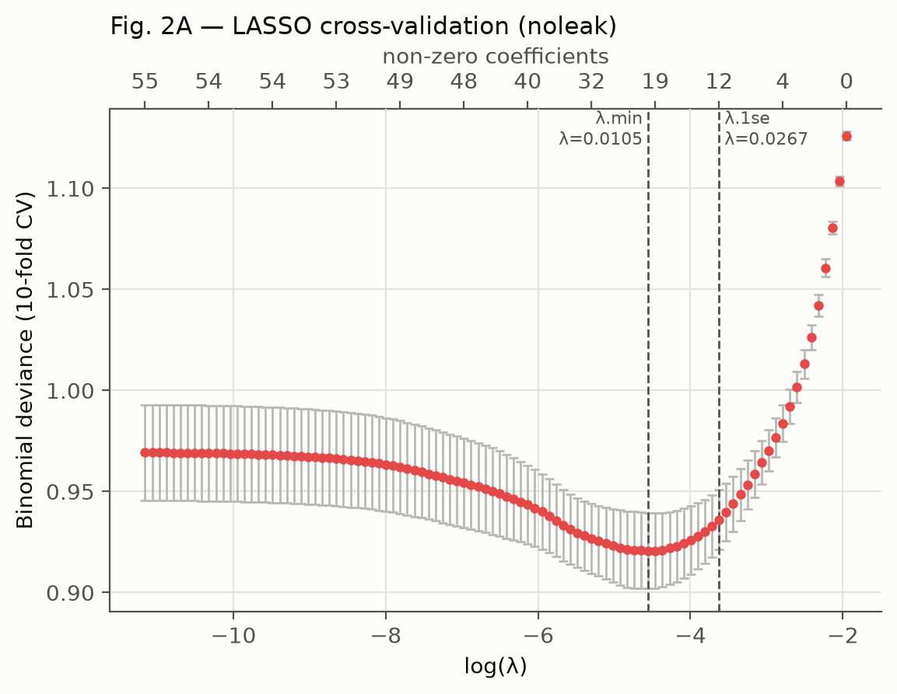
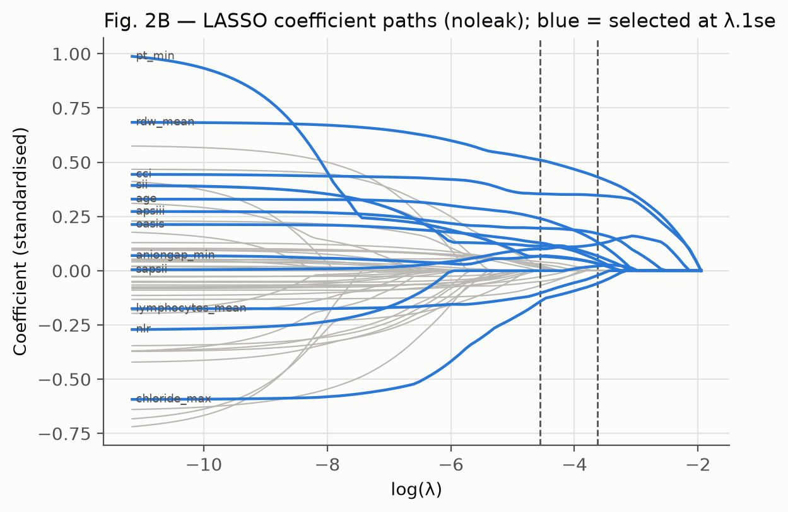

## 6. Model performance

### 6.1 Main estimate: full nested cross-validation (D8.5, D8.6, D8.11)

**Design**: training set of 1,568 patients, outer stratified 10 folds × 5 repeats (seeds 42–46). Inside every outer training fold, the 20% missing-rate rule, imputation, standardisation, LASSO (inner 10 folds, λ.1se) and tuning (inner stratified 5-fold `GridSearchCV`, AUROC) are done in turn, and the models are evaluated on the outer validation fold. All 9 models were run for all 5 repeats; no fold had LASSO selecting 0 variables. Metrics: mean ± SD of AUROC over the 50 outer folds; in each repeat the 10 validation folds are pooled into OOF predictions covering the whole training set, from which AUPRC, Brier, calibration slope etc. are computed and averaged over the 5 repeats. Models are compared with fold-wise paired differences and Nadeau–Bengio-corrected 95% CIs (r = 5, k = 10). Outputs in `replication/nested_cv_full_*_C.csv`.

| Model | AUROC (mean ± SD, 50 folds) | Pooled OOF AUROC | AUPRC (pooled OOF) | Brier / scaled Brier (pooled OOF) | OOF calibration slope | ΔAUROC vs M\* (NB-corrected 95% CI) | Equivalent to M\* |
|---|---|---|---|---|---|---|---|
| XGBoost (paper) | 0.791 ± 0.035 | 0.790 | 0.559 | 0.150 / 0.206 | 0.957 | — (M\*) | yes |
| XGBoost (tuned) | 0.790 ± 0.035 | 0.790 | 0.558 | 0.150 / 0.206 | 0.960 | 0.0003 (-0.0050, +0.0056) | yes |
| LR (L2) | 0.788 ± 0.036 | 0.782 | 0.536 | 0.154 / 0.183 | 1.189 | 0.0024 (-0.0088, +0.0136) | yes |
| RF (tuned) | 0.788 ± 0.036 | 0.785 | 0.548 | 0.154 / 0.185 | 1.483 | 0.0024 (-0.0061, +0.0110) | yes |
| SVM (tuned) | 0.788 ± 0.036 | 0.785 | 0.541 | 0.153 / 0.190 | 0.900 | 0.0029 (-0.0078, +0.0137) | yes |
| LR (unpenalised) | 0.786 ± 0.035 | 0.785 | 0.550 | 0.151 / 0.199 | 0.854 | 0.0048 (-0.0067, +0.0163) | yes |
| RF (paper) | 0.767 ± 0.038 | 0.767 | 0.519 | 0.156 / 0.172 | 0.939 | 0.0237 (+0.0062, +0.0412) | no |
| RF (R defaults) (paper) | 0.724 ± 0.039 | 0.724 | 0.440 | 0.171 / 0.090 | 0.154 | 0.0664 (+0.0428, +0.0899) | no |
| SVM (paper) | 0.723 ± 0.044 | 0.721 | 0.497 | 0.163 / 0.134 | 0.961 | 0.0676 (+0.0421, +0.0932) | no |

The AUPRC baseline (prevalence) is 0.252. RF (R defaults) has 5 outer folds with a non-converged calibration intercept; its calibration is reported from the pooled OOF predictions only.

- **6 models are equivalent**: outer AUROC 0.786–0.791, each within 0.005 of the best model.
- **Not equivalent: the paper-parameter RF (both versions) and SVM** (0.723–0.767): RF (literal parameters) Δ = 0.024 with a CI excluding 0; RF (R defaults) and SVM (paper parameters) Δ ≥ 0.066. Among the paper-parameter models only XGBoost matches the best model.
- Compared with the "LASSO-only nested" CV of stage 7 (Appendix A.5), full nesting gives 0.781 → 0.786 for the unpenalised LR and 0.783–0.789 → 0.788–0.790 for the tuned models; the conclusions do not change. Stage 7 had a single repeat (seed 42), whereas the full nested CV averages 5 repeats, so the difference comes mainly from variation between repeats: in the seed-42 repeat of the full nested CV the values are 0.781 for the unpenalised LR and 0.786 for the tuned RF, and the unpenalised LR ranges over 0.781–0.792 across the 5 repeats.
- The L2 LR's fold-mean AUROC (0.788) is higher than its pooled OOF AUROC (0.782): the inner loop chose a very small C, and strong shrinkage puts each fold's predictions on a different scale, which harms the ranking once they are pooled.

### 6.2 Model selection (pre-specified rule D8.8)

**Rule** (written before any stage-8 analysis was run): (1) the model with the highest mean outer AUROC is M\*; (2) a model is equivalent to M\* if its difference is ≤ 0.01, or if the Nadeau–Bengio 95% CI crosses 0 and the difference is ≤ 0.02; (3) if the equivalent set contains an LR, choose the LR; (4) if both LRs are equivalent, choose the one whose pooled-OOF calibration slope has the smaller |ln slope| (|ln slope| taken in each repeat, then averaged over the 5 repeats), the unpenalised LR on a tie; (5) the held-out set takes no part in the choice. **Steps 2 and 3 are a pre-specified preference for parsimony**: they allow the selected LR's AUROC to be up to 0.02 below the best model (when the CI crosses 0) or 0.01 (regardless of the CI).

**Execution**:
1. M\* = XGBoost (paper) (outer AUROC 0.7907).
2. Equivalent set = XGBoost (paper), LR (unpenalised), RF (tuned), XGBoost (tuned), SVM (tuned), LR (L2).
3. The equivalent set contains an LR → choose an LR.
4. Both LRs are equivalent; calibration slope in each repeat (|ln slope| in brackets):

| Model \ seed | 42 | 43 | 44 | 45 | 46 | mean \|ln slope\| |
|---|---|---|---|---|---|---|
| LR (unpenalised) | 0.830 (0.186) | 0.859 (0.153) | 0.866 (0.144) | 0.866 (0.143) | 0.847 (0.165) | 0.1583 |
| LR (L2) | 1.107 (0.101) | 1.179 (0.165) | 1.369 (0.314) | 1.146 (0.137) | 1.145 (0.135) | 0.1703 |

   Mean |ln slope|: unpenalised LR 0.158, L2 LR 0.170 → **unpenalised LR**. The gap is small and the L2 LR is closer to 1 in 3/5 repeats; this step only breaks the tie by rule and is not evidence that the unpenalised LR is better calibrated. The two deviate from 1 by similar amounts in opposite directions (unpenalised LR slope 0.85, predictions slightly too extreme; L2 LR 1.19, slightly towards the mean).

**Recommended model = unpenalised LR**. The reasons are only three: simplicity (an unpenalised logistic model on 12 LASSO variables), interpretability (coefficients/ORs read directly, with 95% CIs and p values, no penalty strength to choose) and adequate EPV (395 events / 12 selected variables = 32.9). On calibration the two LRs are comparable. **No claim of better discrimination is made**: the unpenalised LR's outer AUROC (0.786) is the lowest of the 6 equivalent models, 0.005 below M\* (95% CI -0.007 to +0.016).

**The pre-specified primary model (D4.7: tuned RF) is still reported**: outer AUROC 0.788, equivalent to M\*; OOF calibration slope 1.48, with predictions shrunk towards the mean.

**History of the model choice** (D4.15, recorded as it happened): the stage-4 pre-specified rule (D4.7, highest 10-fold CV AUC on the training set) selected the tuned RF (CV AUC 0.800, tied with XGBoost; validation AUC 0.793). In paired DeLong tests on the validation set, no pair of tuned models differed significantly after Holm correction; two changes were then made after seeing the validation results: first to the tuned L2 LR (C = 0.01), and then, because of its validation calibration slope of 1.21, to the unpenalised LR. Neither change was in the analysis plan at the time. The stage-8 rule D8.8 also selects the unpenalised LR, but it was written after those results had been seen, so for definition C it is **not blind**; its role is to fix the basis of the choice as a pre-specified criterion on nested CV, not to prove that the post-hoc choice was right.

### 6.3 Secondary estimate: the single held-out validation set (D8.12)

**Note: this validation set (392 patients, 99 deaths) was used in the post-hoc model choice of stages 6–7, so this is a secondary estimate only.** Both models are the stage-4 versions fitted on the whole training set (no-leakage preprocessing + the 12 variables selected at λ.1se); each threshold is the model's own nested-CV pooled-OOF Youden threshold (median of 5 repeats). Outputs `replication/holdout_C.csv`, `holdout_dca_C.csv`.

| Metric | LR (unpenalised) | RF (tuned) |
|---|---|---|
| AUROC (DeLong 95% CI) | 0.803 (0.753–0.853) | 0.793 (0.741–0.845) |
| AUPRC (bootstrap 95% CI; prevalence baseline 0.253) | 0.581 (0.500–0.683) | 0.605 (0.521–0.693) |
| Brier / scaled Brier | 0.145 / 0.234 | 0.153 / 0.192 |
| Calibration intercept / slope | -0.054 / 0.96 | -0.013 / 1.76 |
| Threshold (nested-CV OOF Youden, median of 5 repeats) | 0.2288 | 0.2472 |
| accuracy / precision / recall / F1 / specificity | 0.722 / 0.470 / 0.778 / 0.586 / 0.703 | 0.686 / 0.432 / 0.768 / 0.553 / 0.659 |
| Share flagged high risk | 41.8% | 44.9% |
| DCA (0.05–0.60): net benefit above both treat-all and 0 | 56/56 thresholds (0.05–0.60) | 53/56 thresholds (0.07–0.59) |

- The held-out AUROCs of both models differ from the nested-CV estimates by ≤ 0.017 (LR 0.803 vs 0.786, RF 0.793 vs 0.788), with no sign of additional overfitting.
- The tuned RF's held-out calibration slope is 1.76, in the same direction as its nested-CV OOF slope of 1.48 (shrinkage towards the mean); the unpenalised LR's is 0.96.
- With only 99 deaths, the two AUROC CIs overlap heavily, and the two models are not ranked on this basis.

### 6.4 Thresholds

The main threshold is now **the Youden-optimal threshold of the nested-CV pooled OOF predictions (median of 5 repeats)**: unpenalised LR 0.229 (range 0.220–0.312), tuned RF 0.247. The stage-4 value of 0.259 from non-nested 10-fold OOF predictions (D4.13) and the results at 0.5 are kept in Appendix A.3. A threshold of 0.5 is unsuitable here: 1-year mortality is about 25%, and at 0.5 the recommended LR flags only 16.3% of patients as high risk, with recall 0.44; it also assumes that missing a death costs the same as wrongly flagging a survivor. The Youden index weights sensitivity and specificity equally, which is itself an assumption; in practice the threshold should be chosen with DCA and the intended use. The RF classification metrics reported in the paper are internally consistent only if survival is the positive class (D4.6), so they are not comparable with ours.

### 6.5 Stage 4–7 single-validation-set results (secondary, history)

Stages 4–7 compared all models on the validation set of a single 80/20 split. The detailed tables have moved to Appendix A; only the key points are kept here:
- **Discrimination**: all validation AUCs lie between 0.76 and 0.80, with 95% CIs of about ±0.05; no pair of tuned models differs significantly in paired DeLong tests after Holm correction (smallest adjusted p = 0.13). ΔAUC between the unpenalised LR and the tuned RF = +0.010 (-0.008 to +0.028), p = 0.26 (Appendix A.1, A.2).
- **Calibration** (Appendix A.4): slope 0.96 for the unpenalised LR, 1.21 for the L2 LR, 1.76 for the tuned RF, 0.17 for RF (R defaults).
- **Overfitting and the paper's RF training AUC of 0.999**:

| params | model | train | cv_auc_train | valid | gap_train_minus_valid | flag_overfit |
|---|---|---|---|---|---|---|
| recommended | LR (unpenalised) | 0.802 | 0.793 | 0.803 | -0.000 | False |
| paper | RF | 0.887 | 0.775 | 0.780 | 0.106 | True |
| paper | RF (R defaults) | 0.999 | 0.736 | 0.756 | 0.243 | True |
| paper | SVM | 0.862 | 0.720 | 0.763 | 0.099 | False |
| paper | XGBoost | 0.838 | 0.797 | 0.787 | 0.051 | False |
| tuned | LR (L2) | 0.803 | 0.796 | 0.803 | 0.000 | False |
| tuned | RF | 0.850 | 0.800 | 0.793 | 0.058 | False |
| tuned | SVM | 0.802 | 0.793 | 0.801 | 0.000 | False |
| tuned | XGBoost | 0.834 | 0.800 | 0.782 | 0.052 | False |

Rule: training − validation AUC > 0.10, or training AUC > 0.95 (D4.12).
  - **RF (R defaults: 9 fully grown trees, mtry=2)**: training AUC **0.999**, validation 0.756, a gap of 0.243, **similar to the paper's RF pattern of 0.999 / 0.780**. This is consistent with the explanation that "the paper's RF is `randomForest(ntree=9, mtry=2)` with fully grown trees (nodesize=1), and the listed `max_depth=10, min_samples_split=30, min_samples_leaf=10` had no effect": with the literal parameters our training AUC is only 0.887. Other causes cannot be ruled out, for example the paper computing training AUC on different data or using other unreported settings. Fully grown trees with only 9 trees memorise every training sample; the training AUC carries no information, and the probabilities are severely overconfident (calibration slope 0.17). In the full nested CV, the outer AUROC of RF (R defaults) is only 0.724.
  - If the paper used the training AUC of 0.999 as one reason for RF being best, that would be inappropriate; cross-validated or independent validation performance should be compared instead.

## 7. Clinical utility: DCA and CIC

- **Main (nested-CV pooled OOF, `replication/nested_cv_full_dca_C.csv`)**: over thresholds 0.05–0.60, the number of thresholds at which the net benefit (mean of 5 repeats) exceeds both treat-all and 0: unpenalised LR 56/56 (0.05–0.60), tuned RF 56/56 (0.05–0.60).
- **Secondary (held-out validation set)**: see the table in Section 6.3; unpenalised LR 56/56, tuned RF 53/56.
- The stage-4 DCA/CIC figures on the validation set are kept below (paper: 0.1–0.7): the recommended LR's useful range is about 0.01–0.71; around its Youden threshold, about 378 per 1,000 patients are classified as high risk, of whom about 184 actually die. Over thresholds 0.1–0.4 the models' net benefit differs by at most 0.024.

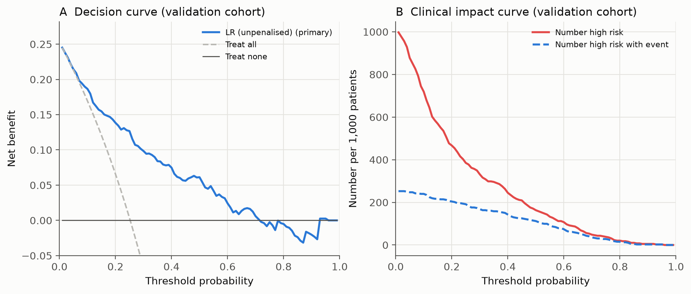
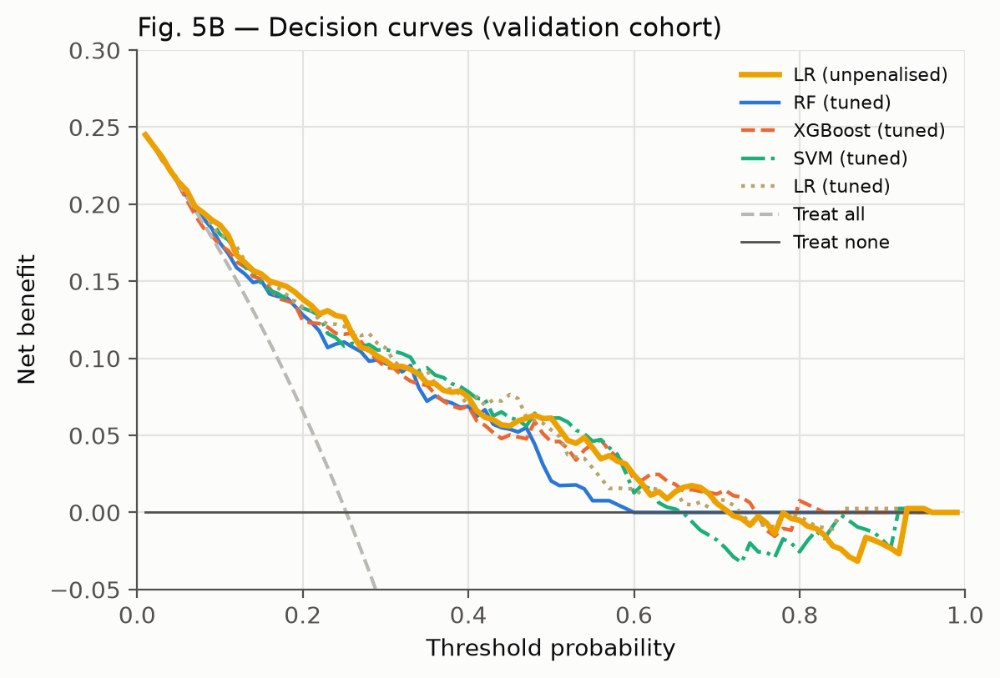

## 8. Model interpretation (Fig. 6, Fig. 8)

### 8.1 Recommended model: coefficients and SHAP of the unpenalised LR

The recommended unpenalised LR is fitted on the standardised values of the 12 LASSO variables (whole training set), so each coefficient is the log odds ratio per 1 standard deviation (SD) increase, with Wald 95% CIs and p values (`tables/lr_coefficients.csv`). The last column gives the tuned L2 LR's OR for comparison.

| Variable | 1 SD (original units) | Unpenalised LR β (per SD) | Unpenalised LR OR (95% CI) | p | Comparison: L2 LR OR | VIF |
|---|---|---|---|---|---|---|
| rdw_mean | 2.24 | +0.567 | 1.76 (1.53–2.03) | <0.001 | 1.50 | 1.18 |
| cci | 2.65 | +0.370 | 1.45 (1.22–1.72) | <0.001 | 1.35 | 1.99 |
| age | 13.5 | +0.339 | 1.40 (1.17–1.69) | <0.001 | 1.25 | 2.05 |
| apsiii | 17.3 | +0.252 | 1.29 (1.05–1.58) | 0.017 | 1.19 | 2.46 |
| lymphocytes_mean | 1.49 | -0.206 | 0.81 (0.67–0.99) | 0.041 | 0.88 | 1.16 |
| sii | 3.12e+03 | +0.187 | 1.21 (0.95–1.52) | 0.118 | 1.10 | 4.02 |
| oasis | 8.23 | +0.186 | 1.20 (1.01–1.44) | 0.042 | 1.14 | 1.99 |
| chloride_max | 6.65 | -0.182 | 0.83 (0.73–0.96) | 0.009 | 0.87 | 1.20 |
| aniongap_min | 3.94 | +0.121 | 1.13 (0.98–1.30) | 0.092 | 1.12 | 1.26 |
| pt_min | 6.16 | +0.117 | 1.12 (1.00–1.26) | 0.053 | 1.12 | 1.07 |
| sapsii | 13 | +0.076 | 1.08 (0.84–1.38) | 0.548 | 1.17 | 3.71 |
| nlr | 11.9 | -0.025 | 0.97 (0.77–1.24) | 0.838 | 1.06 | 4.27 |

- **Independent, significant risk factors** (p < 0.05): RDW, CCI, age, APS-III, OASIS. **Protective factors**: higher chloride_max (i.e. low chloride indicates higher risk, the same direction as the paper) and higher absolute lymphocytes.
- **Interpreting CCI** (D8.2): the mimic-code CCI includes an age score of 0–4 points, while age enters the model separately. The OR of CCI is a conditional effect at fixed age, reflecting mainly comorbidity burden and the part of the age bands not captured by linear age; it cannot be read as a pure comorbidity effect.
- **Collinearity**: SAPS-II, SII and NLR are not significant in the multivariable model, with VIF of about 3.7–4.3, suggesting their information is already covered by other variables. Individual coefficients should not be read as causal effects.
- **SHAP (unpenalised LR, LinearExplainer, validation set, log-odds scale)**: top 5 are rdw_mean, cci, age, apsiii, oasis. The L2 LR's top 5 are rdw_mean, cci, age, apsiii, sapsii.

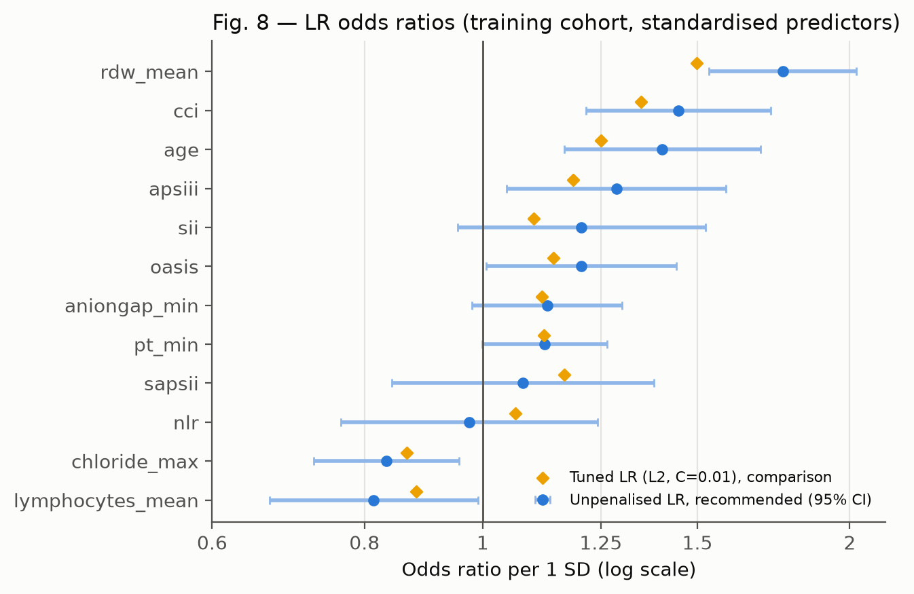
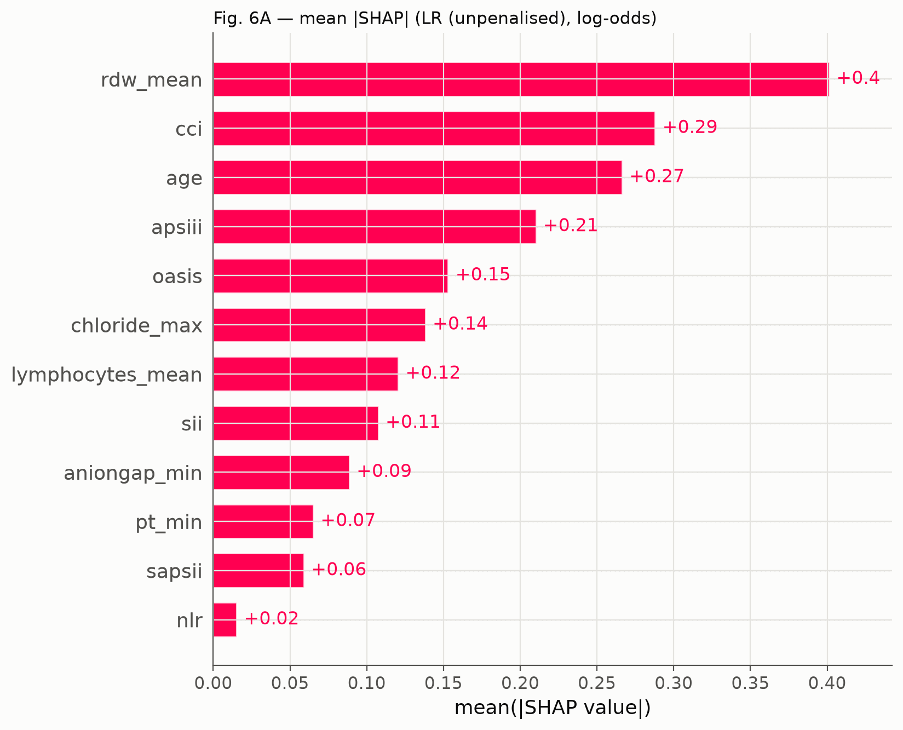
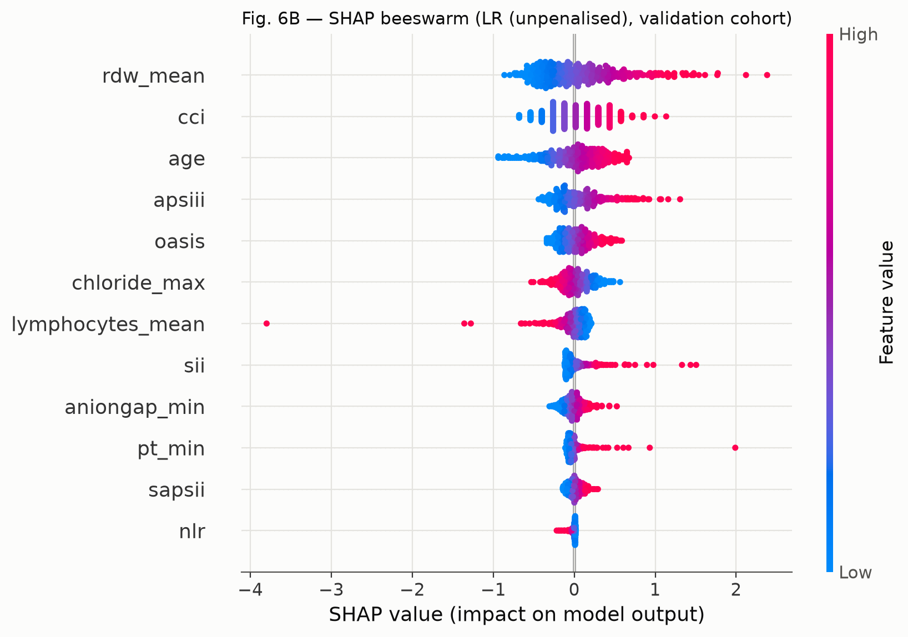

The force plots (one representative case each for a survivor, an in-hospital death and a death within 1 year after discharge, D4.9) show individual patients' feature values and are kept on the local machine only (D5.1).

### 8.2 SHAP compared with the paper

| Rank | Paper (RF) | This study: recommended (unpenalised LR) | This study: comparison (L2 LR) | This study: secondary (tuned RF) | This study: paper configuration (RF, literal parameters) |
|---|---|---|---|---|---|
| 1 | rdw_mean | rdw_mean | rdw_mean | rdw_mean | rdw_mean |
| 2 | neutrophils_mean | cci | cci | cci | sapsii |
| 3 | cci | age | age | sapsii | cci |
| 4 | chloride_max | apsiii | apsiii | apsiii | age |
| 5 | pt_min | oasis | sapsii | chloride_max | apsiii |

- **Consistent with the paper**: RDW_mean is the **top** predictor in every analysis, and CCI is always in the top 3. chloride_max ranks 5th in the RF (low chloride → higher risk, the same direction as the paper) and is a significant protective factor in the LR.
- **Agreement between LR and RF**: the recommended LR and the tuned RF share 3 of their top 5 (rdw_mean, cci, apsiii).
- **Disagreement**: neutrophils_mean is not in our models, whereas it ranks 2nd in the paper. We suspect this may be related to mixed units (Section 3.2), but cannot verify it directly.

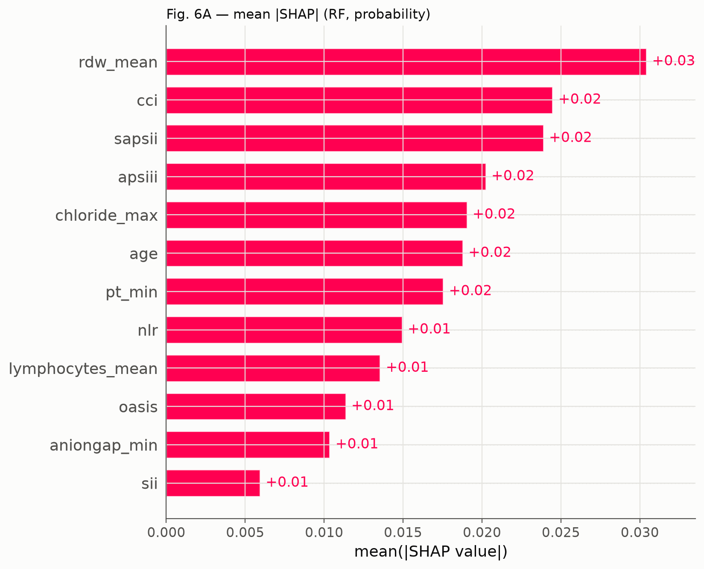
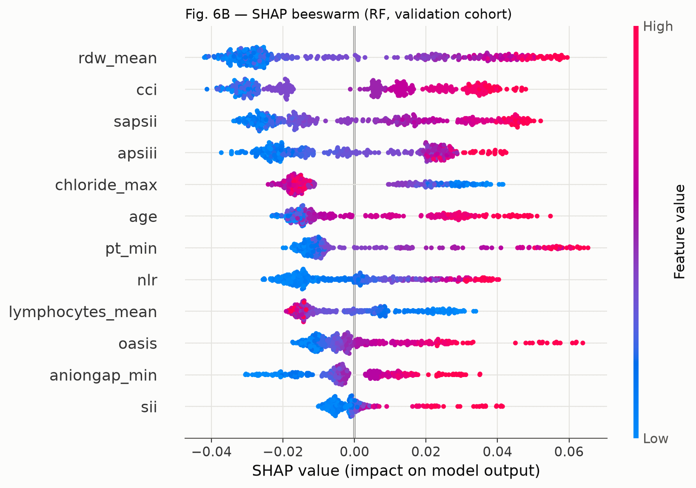

## 9. Sensitivity analyses

### 9.1 Comorbidity timing (D8.2, D8.12)

Under the paper's conditions, comorbidities come from the index admission's `diagnoses_icd`; diagnosis codes have no timestamps and may include acute events of the current admission. This sensitivity analysis recomputes CCI (keeping the age score) and the SAPS-II chronic item from "all codes of prior admissions ∪ codes of the index admission after removing the D8.3 acute codes" (re-using the mimic-code SQL directly; re-running with index-admission codes only reproduces the original concept tables patient by patient), replaces only these two columns, and re-runs the full nested CV for the recommended LR and the tuned RF (same outer splits as the main analysis).

- 1123 patients (57%) have a prior admission; 550 have a D8.3 acute code in the index admission. The median (IQR) CCI is 7 (5, 9) both before and after recomputation; CCI changes for 843 patients (528 up, 315 down), and SAPS-II for 21.

| Comorbidity (charlson component) | Positive (index admission) | Positive (recomputed) | Lost by removing acute codes | Added from prior admissions |
|---|---|---|---|---|
| myocardial_infarct | 611 | 436 | 304 | 129 |
| congestive_heart_failure | 852 | 907 | 20 | 75 |
| peripheral_vascular_disease | 302 | 473 | <10 | 174 |
| cerebrovascular_disease | 260 | 266 | 108 | 114 |
| chronic_pulmonary_disease | 517 | 634 | 0 | 117 |
| renal_disease | 909 | 981 | 0 | 72 |
| malignant_cancer | 190 | 252 | 0 | 62 |
| mild_liver_disease | 213 | 265 | 11 | 63 |
| peptic_ulcer_disease | 62 | 106 | <10 | 45 |

- **The largest change is myocardial infarction**: of 611 original positives, 304 (about half) have only acute index-admission codes (410/I21/I22) and no longer count as prior MI. No index admission in definition C carries a 586/N19 code, so the renal exclusion rule has no effect.
- `diabetes_with_cc` is not 100%: <10 patients have a 249.6x DN code (secondary diabetes with neuropathy), which is not in the charlson diabetes code list (correcting the original wording of D8.2).

| Metric | Unpenalised LR: main | Unpenalised LR: comorbidity timing | Tuned RF: main | Tuned RF: comorbidity timing |
|---|---|---|---|---|
| AUROC (fold mean ± SD) | 0.786 ± 0.035 | 0.787 ± 0.036 | 0.788 ± 0.036 | 0.790 ± 0.036 |
| Pooled OOF AUROC | 0.785 | 0.786 | 0.785 | 0.787 |
| AUPRC (pooled OOF) | 0.550 | 0.548 | 0.548 | 0.545 |
| Brier (pooled OOF) | 0.151 | 0.151 | 0.154 | 0.154 |
| Calibration slope (pooled OOF) | 0.854 | 0.852 | 1.483 | 1.591 |
| ΔAUROC (sensitivity − main, 95% CI) | — | +0.001 (-0.006, +0.008) | — | +0.002 (-0.006, +0.010) |
| Folds selecting CCI / SAPS-II | 50/50, 50/50 | 50/50, 50/50 | 50/50, 50/50 | 50/50, 50/50 |

- **Conclusion**: although CCI changes for 843 patients and about half of the MI positives come from acute codes, discrimination, AUPRC, Brier and the LR's calibration are essentially unchanged for both models (ΔAUROC CIs cross 0), and CCI is still selected in every fold. The conclusion that "CCI is a stable, important predictor" does not depend on when the index-admission codes arose.

### 9.2 Excluding the 2020–2022 group (D4.19)

The 247 patients with `anchor_year_group` "2020 - 2022" are excluded and the modelling pipeline is re-run on the rest (`scripts/04e_sensitivity_pre2020.py`, with a new single stratified 80/20 split).

| Item | Main analysis (all years) | Sensitivity (excluding 2020–2022 group) |
|---|---|---|
| Cohort size (deaths, 1-year mortality) | 1,960 (494, 25.2%) | 1,713 (429, 25.0%) |
| Training / validation (validation deaths) | 1,568 / 392 (99) | 1,370 / 343 (86) |
| LASSO λ.1se (number of variables) | 0.0267 (12) | 0.0264 (11) |
| Variables selected at λ.1se | age, aniongap_min, rdw_mean, lymphocytes_mean, chloride_max, pt_min, sapsii, apsiii, oasis, cci, nlr, sii | age, rdw_mean, lymphocytes_mean, chloride_max, ptt_min, pt_min, sapsii, apsiii, cci, plr, sii |
| Recommended model (unpenalised LR) validation AUC (DeLong 95% CI) | 0.803 (0.752–0.853) | 0.799 (0.747–0.852) |
| Tuned RF validation AUC (DeLong 95% CI) | 0.793 (0.741–0.845) | 0.802 (0.750–0.855) |
| ΔAUC LR − RF (95% CI), p | +0.010 (-0.008 to +0.028), p = 0.26 | -0.003 (-0.021 to +0.016), p = 0.77 |
| LR calibration slope / Brier | 0.96 / 0.145 | 0.93 / 0.148 |
| RF calibration slope / Brier | 1.76 / 0.153 | 1.65 / 0.149 |
| LR SHAP top 5 | rdw_mean, cci, age, apsiii, oasis | rdw_mean, cci, apsiii, age, sapsii |
| RF SHAP top 5 | rdw_mean, cci, sapsii, apsiii, chloride_max | rdw_mean, cci, sapsii, apsiii, pt_min |

- **LASSO**: 11 variables selected; adds ptt_min, plr and drops aniongap_min, oasis, nlr.
- **Conclusion**: By criteria written down before the sensitivity analysis was run (set during this revision, not pre-specified at the start of the project: validation AUC of both models changes by ≤ 0.05, LR and RF still not significantly different, RDW and CCI still in the recommended LR's SHAP top 3), **the main conclusions are robust**; excluding the 2020–2022 group does not change them. The validation set here is a new single split, so AUC differences also include variation from the random split. `anchor_year_group` is a patient-level 3-year anchor band, not the actual year of each admission, so this only approximates "excluding admissions after 2020".

# Part II: Clinical model (CLIN)

## 10. Design, cohort and features (D8.1–D8.4, D8.13)

**Prediction time = 24 h after ICU admission** (landmark), using only information available at that time:
- **Inclusion**: the same index admission as definition C (the first admission with both a DN code and an ICU stay) and its first ICU stay; age ≥ 18; still in the ICU and alive 24 h after ICU admission. Patients whose first ICU stay is shorter than 24 h are excluded outright; a later ICU stay of the same admission is not used instead. LOS > 48 h is **not used** (it depends on information after the prediction time), and a complete CBC is **not required**.
- **Features**: labs, vital signs and scores use the same (first-day) windows as the replication track. The 6 comorbidity variables come from "all codes of prior admissions ∪ codes of the index admission after removing acute-event codes" (D8.3: acute MI, acute heart failure, 586/N19, acute stroke/TIA, aortic dissection, acute peptic ulcer, acute hepatic necrosis/shock liver, etc. are removed); CCI excludes the age score (to avoid counting age twice); the SAPS-II chronic item is recomputed over "prior ∪ index admissions".
- **White-cell differential** (D8.4 method 2): the 8 white-cell-differential variables (the three cell counts and NLR, PLR, LMR, PNR, SII) are exempt from the 20% rule, and one indicator `wbc_diff_missing` (all three cell counts missing) is added as a LASSO candidate; missing values are mean-imputed inside the folds.

| Step | Remaining | Excluded at this step | 1-year deaths | 1-year mortality |
|---|---|---|---|---|
| [1] patients with a DN-coded admission that has an ICU stay | 3189 | 0 | 857 | 26.9% |
| [2] first ICU stay of the index admission (definition C) | 3189 | 0 | 857 | 26.9% |
| [3] age >= 18 | 3189 | 0 | 857 | 26.9% |
| [4] exclude ICU stay < 24 h, alive at 24 h (transferred out) | 2595 | 594 | 718 | 27.7% |
| [5] exclude death before ICU admission + 24 h | 2557 | 38 | 680 | 26.6% |

- **Split**: stratified 80/20 (seed 42): training 2,045 patients (544 deaths, 26.6%), held-out 512 (136 deaths, 26.6%).
- **Comorbidities**: 1,452 patients (56.8%) have a prior admission; the median (IQR) CCI without the age score is 5 (3, 6) from index-admission codes only and 5 (4, 7) under the CLIN rule (1,075 patients change). The D8.3 count for 586/N19 is 0 (< 1%), so as pre-specified the add-back sensitivity analysis is not run.
- **White-cell differential**: `wbc_diff_missing = 1` for 873 patients (34.1%); 21 patients have partial missingness, all because a ratio's denominator was 0 (D2.10). Only these 8 white-cell-differential variables exceed 20% missingness (`clinical/missingness_clin.csv`); the highest among the rest is ptt_max (10.2%).

**Table 1 (whole CLIN cohort by 1-year outcome, observed values before imputation)** (`clinical/table1_clin.csv`; rules as in D3.5, D3.6; 1,877 survivors, 680 deaths; 42 variables with p < 0.05):

| Variable | Missing % | Overall | Survivors | Deaths | p |
|---|---|---|---|---|---|
| age | 0.0 | 67.00 (58.00, 75.00) | 65.00 (57.00, 73.00) | 71.00 (63.00, 79.00) | <0.001 |
| gender_male | 0.0 | 1520 (59.44%) | 1097 (58.44%) | 423 (62.21%) | 0.087 |
| myocardial_infarct | 0.0 | 554 (21.67%) | 374 (19.93%) | 180 (26.47%) | <0.001 |
| congestive_heart_failure | 0.0 | 1178 (46.07%) | 775 (41.29%) | 403 (59.26%) | <0.001 |
| chronic_pulmonary_disease | 0.0 | 828 (32.38%) | 572 (30.47%) | 256 (37.65%) | <0.001 |
| renal_disease | 0.0 | 1299 (50.80%) | 877 (46.72%) | 422 (62.06%) | <0.001 |
| hypertension | 0.0 | 2266 (88.62%) | 1653 (88.07%) | 613 (90.15%) | 0.143 |
| obesity | 0.0 | 859 (33.59%) | 664 (35.38%) | 195 (28.68%) | 0.002 |
| glucose_mean | 1.0 | 163.67 (126.00, 221.00) | 160.67 (125.00, 221.92) | 170.75 (131.00, 218.25) | 0.137 |
| aniongap_min | 0.6 | 13.00 (10.00, 15.00) | 12.00 (10.00, 14.00) | 14.00 (11.00, 17.00) | <0.001 |
| aniongap_max | 0.6 | 16.00 (13.00, 20.00) | 16.00 (13.00, 19.00) | 17.00 (15.00, 21.00) | <0.001 |
| bicarbonate_min | 0.6 | 21.00 (18.00, 24.00) | 21.00 (19.00, 24.00) | 20.00 (17.00, 24.00) | 0.013 |
| bicarbonate_max | 0.6 | 24.00 (22.00, 26.00) | 24.00 (22.00, 26.00) | 24.00 (21.00, 27.00) | 0.144 |
| creatinine_min | 0.6 | 1.20 (0.80, 2.10) | 1.10 (0.80, 1.80) | 1.60 (1.00, 3.10) | <0.001 |
| creatinine_max | 0.6 | 1.40 (1.00, 2.50) | 1.30 (0.90, 2.20) | 2.00 (1.20, 3.60) | <0.001 |
| bun_min | 0.6 | 23.00 (15.00, 39.00) | 21.00 (14.00, 34.00) | 32.00 (20.00, 53.00) | <0.001 |
| bun_max | 0.6 | 29.00 (18.00, 48.00) | 26.00 (17.00, 43.00) | 40.00 (25.00, 63.00) | <0.001 |
| hemoglobin_mean | 0.8 | 10.00 (8.82, 11.40) | 10.10 (8.97, 11.55) | 9.70 (8.45, 10.98) | <0.001 |
| platelets_mean | 0.7 | 197.00 (147.54, 260.92) | 198.00 (151.50, 257.00) | 193.00 (137.00, 274.50) | 0.349 |
| wbc_mean | 0.8 | 11.28 (8.30, 14.90) | 11.25 (8.40, 14.64) | 11.40 (8.03, 15.80) | 0.641 |
| rbc_mean | 0.8 | 3.42 (3.01, 3.91) | 3.46 (3.06, 3.95) | 3.28 (2.85, 3.83) | <0.001 |
| rdw_mean | 0.8 | 14.65 (13.60, 16.20) | 14.30 (13.40, 15.65) | 15.81 (14.49, 17.63) | <0.001 |
| lymphocytes_mean | 34.1 | 1.27 (0.79, 1.95) | 1.39 (0.87, 2.08) | 0.95 (0.60, 1.47) | <0.001 |
| neutrophils_mean | 34.1 | 8.79 (6.16, 12.91) | 8.66 (6.15, 12.49) | 9.17 (6.17, 14.14) | 0.065 |
| monocytes_mean | 34.1 | 0.55 (0.34, 0.84) | 0.53 (0.34, 0.82) | 0.61 (0.36, 0.92) | 0.002 |
| calcium_min | 8.6 | 8.20 (7.80, 8.70) | 8.20 (7.80, 8.70) | 8.20 (7.70, 8.70) | 0.890 |
| calcium_max | 8.6 | 8.60 (8.20, 9.10) | 8.60 (8.20, 9.10) | 8.70 (8.20, 9.20) | 0.577 |
| chloride_min | 0.6 | 101.00 (96.00, 105.00) | 101.00 (97.00, 105.00) | 99.00 (94.00, 104.00) | <0.001 |
| chloride_max | 0.6 | 105.00 (100.00, 109.00) | 106.00 (101.00, 109.00) | 103.00 (98.00, 108.00) | <0.001 |
| sodium_min | 0.6 | 136.00 (133.00, 139.00) | 136.00 (133.00, 139.00) | 136.00 (132.00, 139.00) | 0.294 |
| sodium_max | 0.6 | 139.00 (136.00, 142.00) | 139.00 (137.00, 141.00) | 139.00 (136.00, 142.00) | 0.279 |
| potassium_min | 0.7 | 4.00 (3.70, 4.40) | 4.00 (3.70, 4.40) | 4.10 (3.60, 4.50) | 0.123 |
| potassium_max | 0.7 | 4.70 (4.20, 5.20) | 4.60 (4.20, 5.20) | 4.70 (4.20, 5.40) | 0.047 |
| ptt_min | 10.2 | 28.70 (25.80, 32.80) | 28.05 (25.60, 31.80) | 30.30 (26.90, 35.85) | <0.001 |
| ptt_max | 10.2 | 32.50 (28.30, 43.65) | 31.80 (28.00, 40.80) | 34.60 (29.50, 51.45) | <0.001 |
| pt_min | 9.7 | 13.10 (12.00, 14.90) | 12.90 (11.80, 14.30) | 14.10 (12.40, 17.75) | <0.001 |
| pt_max | 9.7 | 14.40 (12.60, 17.10) | 14.10 (12.50, 16.30) | 15.30 (13.10, 20.45) | <0.001 |
| inr_min | 9.7 | 1.20 (1.10, 1.40) | 1.20 (1.10, 1.30) | 1.30 (1.10, 1.60) | <0.001 |
| inr_max | 9.7 | 1.30 (1.10, 1.60) | 1.30 (1.10, 1.50) | 1.40 (1.20, 1.90) | <0.001 |
| heart_rate_mean | 0.1 | 82.92 (73.99, 93.65) | 83.12 (74.74, 93.36) | 82.69 (72.55, 94.60) | 0.495 |
| mbp_mean | 0.1 | 76.33 (70.48, 84.18) | 77.11 (71.06, 85.21) | 74.46 (68.90, 82.08) | <0.001 |
| resp_rate_mean | 0.2 | 18.28 (16.43, 20.62) | 18.08 (16.32, 20.20) | 19.12 (16.99, 21.75) | <0.001 |
| temperature_mean | 2.9 | 36.82 (36.61, 37.07) | 36.83 (36.64, 37.07) | 36.78 (36.54, 37.09) | 0.003 |
| sapsii | 0.0 | 36.00 (29.00, 45.00) | 34.00 (27.00, 42.00) | 42.00 (35.00, 52.25) | <0.001 |
| apsiii | 0.0 | 45.00 (35.00, 57.00) | 42.00 (34.00, 53.00) | 54.00 (43.00, 67.00) | <0.001 |
| lods | 0.0 | 4.00 (3.00, 6.00) | 4.00 (3.00, 6.00) | 6.00 (4.00, 8.00) | <0.001 |
| oasis | 0.0 | 30.00 (25.00, 36.00) | 30.00 (24.00, 35.00) | 33.50 (27.00, 40.00) | <0.001 |
| gcs | 0.1 | 15.00 (14.00, 15.00) | 15.00 (14.00, 15.00) | 15.00 (13.00, 15.00) | <0.001 |
| cci | 0.0 | 5.00 (4.00, 7.00) | 5.00 (3.00, 6.00) | 6.00 (5.00, 8.00) | <0.001 |
| nlr | 34.3 | 6.85 (3.92, 12.41) | 6.13 (3.67, 10.77) | 9.70 (5.59, 17.93) | <0.001 |
| plr | 34.3 | 155.12 (91.29, 262.30) | 145.88 (87.55, 238.82) | 197.53 (118.71, 332.26) | <0.001 |
| lmr | 34.7 | 2.36 (1.24, 4.15) | 2.74 (1.41, 4.56) | 1.61 (0.88, 2.83) | <0.001 |
| pnr | 34.2 | 21.60 (14.66, 32.54) | 22.07 (15.30, 33.08) | 20.15 (12.92, 31.75) | 0.002 |
| pwr | 0.8 | 17.52 (12.18, 24.91) | 17.57 (12.27, 25.17) | 17.41 (11.94, 24.46) | 0.139 |
| sii | 34.3 | 1331.54 (645.68, 2659.44) | 1198.21 (614.90, 2397.44) | 1734.57 (826.64, 3447.86) | <0.001 |
| wbc_diff_missing | 0.0 | 873 (34.14%) | 623 (33.19%) | 250 (36.76%) | 0.092 |
| has_prior_admission | 0.0 | 1452 (56.79%) | 1028 (54.77%) | 424 (62.35%) | <0.001 |

## 11. Nested cross-validation and model selection (D8.14)

Training set of 2,045 patients, same design as Section 6.1 (5 × 10 folds, r = 5, k = 10). 56 candidate variables (55 + `wbc_diff_missing`); the 20% rule dropped no variable in any fold; LASSO selected 13–23 variables per fold (median 17). Outputs in `clinical/nested_cv_full_*_clin.csv`.

| Model | AUROC (mean ± SD, 50 folds) | Pooled OOF AUROC | AUPRC (pooled OOF) | Brier / scaled Brier (pooled OOF) | OOF calibration slope | ΔAUROC vs M\* (NB-corrected 95% CI) | Equivalent to M\* |
|---|---|---|---|---|---|---|---|
| LR (L2) | 0.801 ± 0.026 | 0.801 | 0.594 | 0.151 / 0.227 | 1.108 | — (M\*) | yes |
| LR (unpenalised) | 0.799 ± 0.026 | 0.798 | 0.592 | 0.151 / 0.226 | 0.897 | 0.0028 (-0.0010, +0.0065) | yes |
| SVM (tuned) | 0.798 ± 0.028 | 0.796 | 0.584 | 0.153 / 0.217 | 0.920 | 0.0036 (-0.0022, +0.0094) | yes |
| RF (tuned) | 0.797 ± 0.028 | 0.795 | 0.591 | 0.155 / 0.207 | 1.465 | 0.0042 (-0.0052, +0.0137) | yes |
| XGBoost (tuned) | 0.795 ± 0.028 | 0.793 | 0.596 | 0.152 / 0.221 | 0.989 | 0.0059 (-0.0035, +0.0154) | yes |
| XGBoost (paper) | 0.794 ± 0.029 | 0.792 | 0.597 | 0.152 / 0.220 | 1.019 | 0.0077 (-0.0018, +0.0173) | yes |
| RF (paper) | 0.781 ± 0.029 | 0.780 | 0.560 | 0.157 / 0.196 | 1.088 | 0.0203 (+0.0081, +0.0325) | no |
| SVM (paper) | 0.756 ± 0.035 | 0.755 | 0.550 | 0.161 / 0.175 | 0.980 | 0.0456 (+0.0265, +0.0646) | no |
| RF (R defaults) (paper) | 0.740 ± 0.037 | 0.739 | 0.488 | 0.170 / 0.130 | 0.180 | 0.0613 (+0.0391, +0.0835) | no |

The AUPRC baseline (prevalence) is 0.266.

**Applying D8.8**:
1. M\* = **LR (L2)** (outer AUROC 0.8013).
2. Equivalent set = XGBoost (paper), LR (unpenalised), RF (tuned), XGBoost (tuned), SVM (tuned), LR (L2) (each within 0.0077 of M\*). RF (literal parameters) Δ = 0.0203 > 0.02, not equivalent; SVM (paper parameters) and RF (R defaults) are further behind.
3. The equivalent set contains an LR → choose an LR.
4. Both LRs are equivalent; calibration slope in each repeat (|ln slope| in brackets):

| Model \ seed | 42 | 43 | 44 | 45 | 46 | mean \|ln slope\| |
|---|---|---|---|---|---|---|
| LR (unpenalised) | 0.908 (0.097) | 0.885 (0.122) | 0.864 (0.146) | 0.904 (0.101) | 0.927 (0.076) | 0.1085 |
| LR (L2) | 1.115 (0.109) | 1.098 (0.093) | 1.084 (0.081) | 1.112 (0.106) | 1.132 (0.124) | 0.1024 |

   Mean |ln slope|: L2 LR 0.1024, unpenalised LR 0.1085 → **L2 LR**.

**The rule decided a near tie**: the two LRs' AUROCs differ by 0.0028 (CI crossing 0), their mean |ln slope| by only 0.006, and the unpenalised LR is closer to 1 in 3/5 repeats. This step only breaks the tie by the pre-specified rule and is not evidence that the L2 LR is better calibrated; the two deviate from 1 by similar amounts in opposite directions (L2 LR 1.11, unpenalised LR 0.90). The CLIN choice differs from definition C (unpenalised LR) only because of this step.

- **No claim of better discrimination**: the L2 LR happens to be M\*, but it is within 0.008 of every other equivalent model with CIs crossing 0. The stated reasons are only simplicity, interpretability and "the two LRs are comparably calibrated". Steps 2 and 3 are a pre-specified preference for parsimony.
- Inner tuning of the L2 LR chose C = 0.01 in 50/50 folds (grid 0.001–100 and ∞; 0.01 is not on the boundary), i.e. fairly strong shrinkage.
- **Tuned RF**: outer AUROC 0.797, equivalent to M\*; pooled-OOF calibration slope 1.46, with predictions shrunk towards the mean, in the same direction as in definition C.
- **LASSO selection frequency** (folds out of 50), top 15: age 50, aniongap_min 50, cci 50, oasis 50, apsiii 50, resp_rate_mean 50, rdw_mean 50, chloride_max 50, obesity 50, bun_min 49, sapsii 47, pt_min 46, nlr 45, ptt_min 35, lmr 33; `wbc_diff_missing` 13/50. Of the 6 comorbidities only obesity is selected (50/50); MI, heart failure, chronic pulmonary disease, renal disease and hypertension are all 0/50.
- **Thresholds** (nested-CV pooled-OOF Youden, median of 5 repeats): L2 LR 0.2578 (0.239–0.277), tuned RF 0.2414 (0.233–0.266).

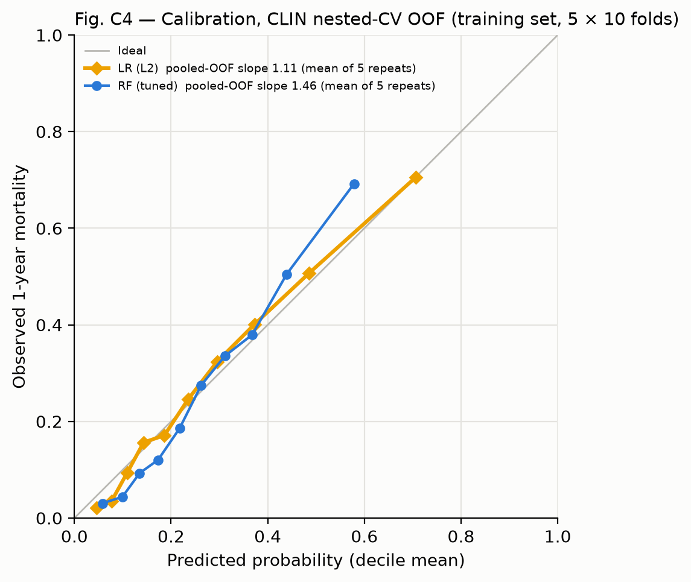

## 12. Freezing and the confirmatory held-out evaluation (D8.14, D8.15, D8.17)

### 12.1 Freezing procedure

- The **frozen specification** `clinical/frozen_model_clin.json` was written and committed before the held-out set was read: on the training set, the 20% rule (white-cell differential exempt) → imputation → standardisation → LASSO (inner 10 folds, seed 42, λ.1se) → LR (L2) with C chosen by inner stratified 5-fold `GridSearchCV`; the tuned RF comparator follows the same procedure; thresholds are the nested-CV pooled-OOF Youden thresholds (LR 0.2578, RF 0.2414); the training stay_id hash, candidate-matrix hash, code hashes and git commit are recorded.
- `scripts/04h_final_clin.py` fits the model as specified; the fit record `clinical/final_model_clin.json` includes the model file's sha256.
- Before reading the held-out set, `scripts/04i_holdout_clin.py` checks three guards: the frozen files are committed and unchanged; the model file matches the frozen specification; no output file exists (no overwriting). A smoke test on a training subsample (not reading the held-out set) was run first. The confirmatory evaluation was **run exactly once**.
- The two sensitivity analyses (Section 14) were run after the held-out evaluation; they concern only the selected model and the tuned RF, take no part in model selection and do not change the frozen model.
- For the figures (Fig. C1–C3), `scripts/04j_plots_clin.py` predicts the held-out set again with the frozen model file (nothing is refitted); every recomputed metric is identical to `holdout_clin.csv` and `holdout_dca_clin.csv` (difference < 1e-9), and no conclusion changed (D8.17).

### 12.2 Final model

- Training set of 2,045 patients with 544 events; 56 candidate variables, 0 dropped by the 20% rule.
- LASSO λ.1se = 0.0168, selecting **22** variables (at the upper end of the 13–23 seen across nested-CV folds): age, gender_male, obesity, aniongap_min, bun_min, rdw_mean, monocytes_mean, calcium_min, chloride_max, ptt_min, pt_min, resp_rate_mean, sapsii, apsiii, lods, oasis, cci, nlr, plr, lmr, sii, wbc_diff_missing.
- LR (L2): C = 0.01; tuned RF: max_depth 10, max_features 2, min_samples_leaf 20.
- **EPV = 24.7** (events / selected variables); events / candidate variables = 9.7.

### 12.3 Held-out results (confirmatory estimate)

Held-out set of 512 patients with 136 deaths. Outputs `clinical/holdout_clin.csv`, `holdout_dca_clin.csv`.

| Metric | LR (L2) | RF (tuned) |
|---|---|---|
| AUROC (DeLong 95% CI) | 0.750 (0.702–0.797) | 0.752 (0.704–0.799) |
| AUPRC (bootstrap 95% CI; prevalence baseline 0.266) | 0.533 (0.459–0.611) | 0.529 (0.460–0.615) |
| Brier / scaled Brier | 0.165 / 0.153 | 0.164 / 0.161 |
| Calibration intercept / slope | +0.049 / 0.82 | +0.013 / 1.14 |
| Threshold (nested-CV OOF Youden, median of 5 repeats) | 0.2578 | 0.2414 |
| accuracy / precision / recall / F1 / specificity | 0.693 / 0.449 / 0.684 / 0.542 / 0.697 | 0.645 / 0.411 / 0.779 / 0.538 / 0.596 |
| Share flagged high risk | 40.4% | 50.4% |
| DCA (0.05–0.60): net benefit above both treat-all and 0 | 53/56 thresholds (0.08–0.60) | 55/56 thresholds (0.06–0.60) |
| Paired DeLong: LR (L2) − RF (tuned) | -0.002 (-0.021, +0.016), p = 0.83 | — |

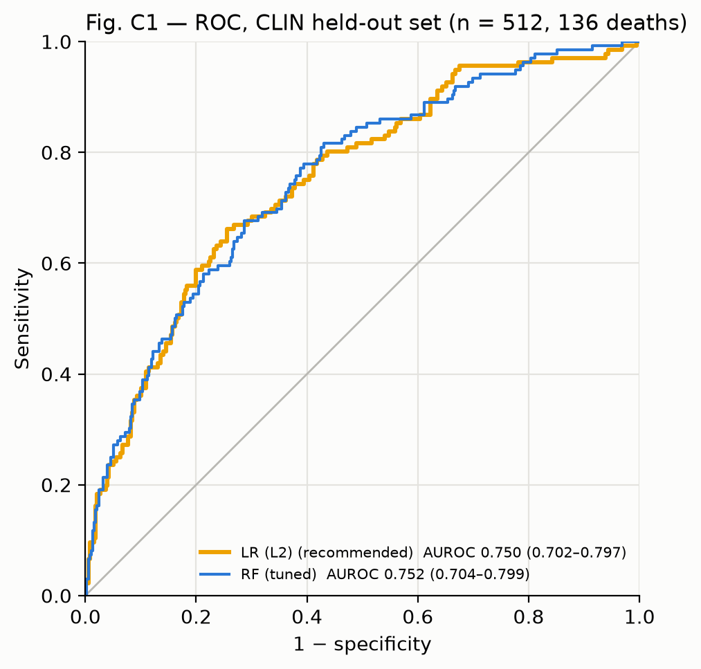
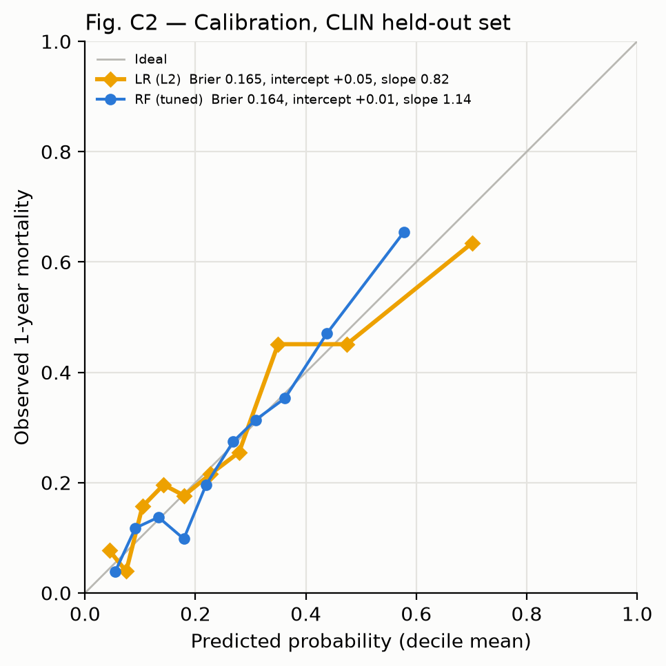
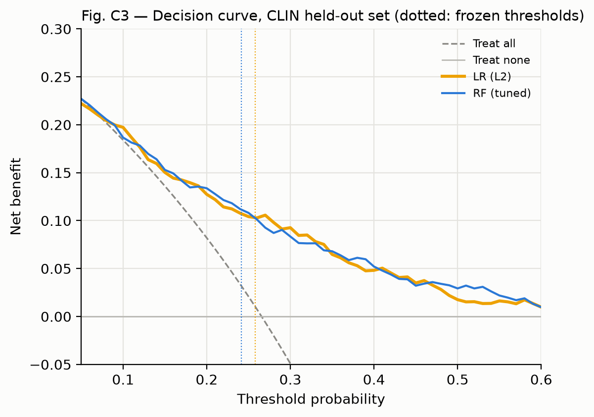

### 12.4 Held-out AUROC below the nested-CV estimate

- **The confirmatory estimate for CLIN is the held-out AUROC of 0.750 (0.702–0.797)**, about 0.05 below the nested-CV estimate: LR (L2) 0.801 → 0.750, tuned RF 0.797 → 0.752. **Both models drop in parallel**, and the nested-CV estimate lies above the upper limit of the held-out 95% CI.
- The following checks are descriptive analyses done after seeing the result; they change neither the frozen model nor the confirmatory result (`clinical/holdout_gap_diagnostics_clin.csv`):
  - **Overfitting looks unlikely**: the frozen LR's apparent AUROC on the training set is 0.817, only 0.016 above nested CV; the L2 shrinkage is strong (C = 0.01), and nested CV already includes variable selection and tuning.
  - **Size of sampling variation**: resampling the training set's nested-CV pooled OOF predictions with replacement to the held-out composition (136 deaths / 376 survivors) 10,000 times gives a mean AUROC of 0.800, SD 0.021, 2.5th percentile 0.755; 1.4% of resamples are ≤ 0.750. This simulation omits the variation from refitting the model and so understates the total variation.
  - **Distribution differences**: across the 22 selected variables, the largest standardised mean difference between training and held-out sets is 0.11 (calcium_min), with 3 above 0.1 (calcium_min, lods, rdw_mean); the split is stratified random, with no time difference.
- **Interpretation**: the gap more likely reflects sampling variation in a 512-patient held-out set (the result lies in the lower tail of the resampling distribution) than overfitting, but other causes cannot be excluded. As pre-specified, **the model is not changed and the evaluation is not repeated**. The report gives both the nested-CV estimate 0.801 and the held-out estimate 0.750; taken together, CLIN's discrimination lies between 0.75 and 0.80.
- LR (L2) and the tuned RF do not differ on the held-out set (p = 0.83), and their AUPRC and Brier are similar.

### 12.5 Calibration: recalibration needed before deployment

- On the held-out set the L2 LR's calibration slope is **0.82** (intercept +0.049), predictions slightly too extreme; its nested-CV OOF slope is 1.11 (slightly towards the mean), so **the deviation points in opposite directions in the two estimates**. The tuned RF's held-out slope is 1.14 (nested CV 1.46).
- Calibration is unstable across samples, so the model **must be recalibrated in the target population before deployment** (at least re-estimating intercept and slope), and the threshold should be re-set for the intended use after recalibration.

## 13. Model interpretation (`clinical/coefs_clin.csv`, `clinical/shap_clin.csv`)

The L2 LR's penalised ORs (per SD) describe the frozen model itself; inference uses the unpenalised LR on the same 22 variables (statsmodels GLM, training set, as in D4.16), with Wald 95% CIs, p values and VIF.

| Variable | 1 SD (original units) | L2 LR OR (per SD, penalised) | Unpenalised LR OR (95% CI) | Unpenalised LR OR (yes vs no, 95% CI) | p (unpenalised) | VIF |
|---|---|---|---|---|---|---|
| rdw_mean | 2.26 | 1.47 | 1.67 (1.47–1.89) | — | <0.001 | 1.28 |
| cci | 2.39 | 1.34 | 1.44 (1.27–1.63) | — | <0.001 | 1.35 |
| age | 13.2 | 1.31 | 1.50 (1.30–1.75) | — | <0.001 | 1.56 |
| apsiii | 18.5 | 1.22 | 1.38 (1.14–1.67) | — | 0.001 | 2.85 |
| chloride_max | 6.69 | 0.85 | 0.82 (0.73–0.94) | — | 0.003 | 1.36 |
| obesity | 0.471 | 0.85 | 0.80 (0.71–0.91) | 0.63 (0.49–0.81) | <0.001 | 1.05 |
| oasis | 8.44 | 1.16 | 1.23 (1.04–1.46) | — | 0.018 | 2.32 |
| resp_rate_mean | 3.43 | 1.15 | 1.20 (1.06–1.34) | — | 0.003 | 1.14 |
| sapsii | 13.4 | 1.13 | 1.02 (0.80–1.29) | — | 0.904 | 4.74 |
| pt_min | 6.36 | 1.13 | 1.12 (1.00–1.26) | — | 0.052 | 1.18 |
| lmr | 4.38 | 0.89 | 0.82 (0.66–1.02) | — | 0.081 | 1.19 |
| calcium_min | 0.775 | 1.11 | 1.16 (1.02–1.32) | — | 0.022 | 1.17 |
| wbc_diff_missing | 0.473 | 1.10 | 1.15 (1.02–1.29) | 1.33 (1.04–1.71) | 0.022 | 1.03 |
| aniongap_min | 3.85 | 1.10 | 1.09 (0.95–1.25) | — | 0.212 | 1.50 |
| bun_min | 23.9 | 1.08 | 1.06 (0.92–1.22) | — | 0.403 | 1.77 |
| gender_male | 0.491 | 1.08 | 1.14 (1.01–1.28) | 1.31 (1.03–1.66) | 0.030 | 1.04 |
| lods | 2.82 | 1.08 | 1.07 (0.88–1.29) | — | 0.524 | 3.26 |
| plr | 177 | 1.07 | 1.09 (0.92–1.30) | — | 0.308 | 2.90 |
| monocytes_mean | 0.53 | 1.07 | 1.07 (0.95–1.21) | — | 0.262 | 1.19 |
| ptt_min | 10.1 | 1.07 | 1.07 (0.96–1.19) | — | 0.250 | 1.13 |
| sii | 2.51e+03 | 1.04 | 1.04 (0.86–1.27) | — | 0.666 | 4.00 |
| nlr | 10 | 1.04 | 1.02 (0.85–1.23) | — | 0.849 | 3.56 |

- **Variables with p < 0.05 in the unpenalised model** (OR, 95% CI; per SD for continuous variables, yes vs no for binary variables): rdw_mean 1.67 (1.47–1.89, per SD), age 1.50 (1.30–1.75, per SD), cci 1.44 (1.27–1.63, per SD), apsiii 1.38 (1.14–1.67, per SD), obesity 0.63 (0.49–0.81, yes vs no), oasis 1.23 (1.04–1.46, per SD), chloride_max 0.82 (0.73–0.94, per SD), resp_rate_mean 1.20 (1.06–1.34, per SD), calcium_min 1.16 (1.02–1.32, per SD), wbc_diff_missing 1.33 (1.04–1.71, yes vs no), gender_male 1.31 (1.03–1.66, yes vs no).
- **Collinearity**: the largest VIFs are sapsii 4.74, sii 4.00, nlr 3.56, all < 5; SAPS-II, LODS, NLR, SII etc. are not significant with the other scores/ratios held fixed.
- **SHAP** (LR (L2), held-out set, LinearExplainer, log-odds scale, training set as background), top 10: rdw_mean, cci, age, apsiii, obesity, chloride_max, oasis, resp_rate_mean, sapsii, wbc_diff_missing. **The top 3 are the same as for the recommended model in definition C** (rdw_mean, cci, age).
- obesity has OR < 1 (yes vs no 0.63, 0.49–0.81), as does chloride_max, in the same direction as definition C's Table 1; for the interpretation of obesity see Section 17.3.

## 14. Sensitivity analyses (D8.3, D8.4 revisions, D8.16)

Both analyses run the full 5 × 10 nested CV for the L2 LR and the tuned RF only, on the same outer splits as the main analysis; ΔAUROC is the paired Nadeau–Bengio 95% CI.

| Metric | LR (L2) main | LR (L2) prior_only | LR (L2) no_wbc_diff | Tuned RF main | Tuned RF prior_only | Tuned RF no_wbc_diff |
|---|---|---|---|---|---|---|
| AUROC (fold mean ± SD) | 0.801 ± 0.026 | 0.787 ± 0.029 | 0.802 ± 0.027 | 0.797 ± 0.028 | 0.789 ± 0.030 | 0.795 ± 0.029 |
| ΔAUROC (sensitivity − main, 95% CI) | — | -0.014 (-0.023, -0.0045) | +0.001 (-0.005, +0.007) | — | -0.008 (-0.016, -0.0001) | -0.002 (-0.010, +0.005) |
| AUPRC (pooled OOF) | 0.594 | 0.574 | 0.603 | 0.591 | 0.582 | 0.589 |
| Brier (pooled OOF) | 0.151 | 0.155 | 0.150 | 0.155 | 0.156 | 0.155 |
| Calibration slope (pooled OOF) | 1.108 | 1.075 | 1.113 | 1.465 | 1.372 | 1.431 |
| Variables selected by LASSO (median, range) | 17 (13–23) | 16 (10–22) | 13 (12–18) | 17 (13–23) | 16 (10–22) | 13 (12–18) |

- **prior_only** (the 6 comorbidities, CCI without age score and the SAPS-II chronic item from prior-admission diagnoses only; comorbidities set to 0 for patients without a prior admission; `has_prior_admission` as a candidate): discrimination falls slightly with CIs excluding 0 (LR (L2) -0.014, RF -0.008). The largest change is obesity, whose selection falls from 50/50 to 4/50; cci 50 → 46/50, myocardial_infarct 0 → 16/50, `has_prior_admission` 0/50. The main analysis uses chronic codes of the index admission and relies on the assumption that they represent conditions present before admission; prior_only does not rely on that assumption and is therefore **reported as the more conservative deployment estimate** (nested-CV AUROC about 0.787).
- **no_wbc_diff** (the 8 white-cell-differential variables go through the 20% rule inside the folds and are dropped in every fold, 8 per fold; no `wbc_diff_missing`): discrimination, AUPRC, Brier and calibration are essentially unchanged (LR (L2) +0.001, RF -0.002, CIs crossing 0), and the median number of selected variables goes from 17 to 13. The white-cell differential adds no detectable discrimination in CLIN and can be omitted without loss. The frozen model and the main analysis are unchanged.

# Part III: Comparison with the paper, limitations and future work

## 15. Summary of differences from the paper and possible reasons

| Item | Paper | This study | Main reason |
|---|---|---|---|
| Data release | v2.x (2008–2019) | v3.1 (2008–2022) | Patients from 2020–2022 added |
| DN patients / final n | 4,137 / 1,313 | 8,992 / 1,960 (definition C) | Data release; retention at later steps is consistent |
| Mortality | 38.2% | 25.2% | The paper may have counted any non-missing dod (our cohort gives 42.8% under that definition); we use an explicit 1-year window |
| Hypertension prevalence | 37.3% | 84.6% | The paper may have counted only uncomplicated hypertension (35.4% in our cohort); that definition misclassifies hypertensive CKD/heart failure as "no hypertension" (Section 3.3) |
| Lymphocytes / neutrophils / monocytes | Implausibly wide distributions | Physiological range (K/uL) | The paper may have mixed units/scales |
| PLR / PNR | 36 / 6.6 | 159 / 22 | Same as above; NLR/LMR/SII/PWR agree with the paper, supporting the mixed-units explanation |
| LASSO λ.min / λ.1se | 0.0106 / 0.0269 | 0.0105 / 0.0267 | Almost identical |
| LASSO λ.1se variables | 12 | 12, 7 shared | Mixed-unit variables; collinearity among scores |
| Performance estimate | Single validation set | Full nested CV (main) + single held-out set (secondary) | Nested CV keeps variable selection and tuning inside the folds and gives a more stable estimate |
| Best model | RF (validation 0.780) | Definition C: 6 equivalent models (nested CV 0.786–0.791), unpenalised LR recommended by the pre-specified rule; CLIN: L2 LR (nested CV 0.801, held-out 0.750) | The paper's RF training AUC of 0.999 is consistent with overfitting; the paper-parameter RF is not equivalent to the best model in nested CV |
| RF training AUC | 0.999 | 0.999 (R defaults) / 0.850 (tuned) | Consistent with the explanation that the paper's RF used fully grown trees |
| Classification metrics | Survival as positive class, threshold not stated | Death as positive class; nested-CV OOF Youden threshold | The paper's metrics may have used survival as the positive class (inferred) |
| SHAP top 5 | RDW, neutrophils, CCI, chloride_max, PT_min | Definition C LR: rdw_mean, cci, age, apsiii, oasis; CLIN LR (L2): rdw_mean, cci, age, apsiii, obesity | RDW first and CCI in the top 3 agree; neutrophils may be affected by mixed units |

**Agreement in trends and conclusions**: consistent with the paper, RDW, CCI, illness-severity scores, age and low chloride are the main predictors of 1-year death in DN patients, and discrimination is moderate (about 0.75–0.80). The disagreement is "RF is best": in full nested CV the tuned models of all types are equivalent, and the paper-parameter RF is in fact significantly worse.

## 16. Unclear points in the paper's methods and how we handled them

| Unclear point | Our handling | Decision |
|---|---|---|
| MIMIC-IV release not stated | v3.1, covering 2008–2022 | — |
| "first ICU admission at first hospitalization" | This study uses definition C (first admission with both a DN code and an ICU stay + its first ICU stay); headcount and mortality of 3 alternative definitions also listed | D1.2, D8.1 |
| Death outcome and follow-up not defined ("survival status") | 1-year all-cause death from ICU admission, an explicit window at date granularity | D1.6, D8.10 |
| First-day window not defined | mimic-code: labs [intime−6h, intime+24h], vital signs [intime, intime+24h] | D1.5, D2.3 |
| Items meant by "complete blood counts were not missing" | 8 items (WBC, Hb, PLT, RBC, RDW + three absolute white-cell counts) | D1.5 |
| Codes for hypertension and obesity not given | Quan-Elixhauser definitions; uncomplicated hypertension only as sensitivity analysis | D2.9, D4.10 |
| Units of the white-cell differential | mimic-code absolute counts (K/uL) | D2.2, D2.11 |
| Imputation and the 20% missing-rate rule applied to all data (leakage) | Faithful and no-leakage versions in parallel; in nested CV the 20% rule, imputation and standardisation are all done inside the folds | D3.4, D8.4 |
| Table 1 computed after imputation | Observed data; post-imputation version saved separately | D3.5 |
| LASSO criterion (text says MSE, figure shows binomial deviance) | Binomial deviance (glmnet default for binary outcomes) | D4.1 |
| RF parameters (R and sklearn names mixed) | Two RF versions: literal parameters / R defaults | D4.4 |
| Tuning grid not reported | Grid search, done in the inner loop of nested CV | D4.5, D8.5 |
| Positive class and threshold of the classification metrics | Death as positive class; nested-CV OOF Youden threshold | D4.6, D8.6 |
| Basis for choosing the best model | Pre-specified rule D8.8 + full nested CV (held-out set not used for the choice); the post-hoc choice of stages 4–7 recorded as it happened | D8.8, D4.15 |
| Data years (v2.x ends in 2019) | Main analysis uses all years; sensitivity analysis excludes the 2020–2022 group | D4.19 |

## 17. Limitations

### 17.1 Limitations shared by both tracks

1. **Single centre, retrospective**: MIMIC-IV comes from one hospital (BIDMC) and there is no external validation. The held-out set has only 99 deaths in definition C and 136 in CLIN, so single held-out estimates have 95% CIs of about ±0.05.
2. **Different data release**: v3.1 and the paper's v2.x cover different years, so item-by-item comparisons with the paper can only show trends.
3. **DN identified by ICD codes**: the sensitivity and specificity of the codes are unknown and coding practice changed over time; inclusion rests on index-admission codes under the assumption that DN is a chronic condition present before admission; the cohort contains only ICU patients.
4. **Diagnosis codes have no timestamps**: definition C uses all index-admission codes, as in the paper, including acute events of the current admission (about half of MI comes from acute codes, Section 9.1); CLIN removes explicit acute codes, but the chronic codes it keeps are equally untimed, and hemiplegia codes may come from an acute stroke during the current admission.
5. **Outcome follow-up**: `dod` covers up to 1 year after the last discharge, so all deaths within 365 days of ICU admission fall within follow-up (D8.10); longer-term outcomes cannot be studied and causes of death cannot be distinguished; the state linkage relies on name, date of birth and social security number, so deaths out of state may be missed.
6. **First-day features**: the original V3 static analysis uses first-day summaries without treatment information (e.g. vasopressors, mechanical ventilation). Part IV adds 0–24 h temporal ablations, which show no clear gain; longer observation windows have not been explored. Some scores still overlap and are collinear with the raw variables.

### 17.2 Replication track (definition C)

7. **LOS > 48 h depends on information after the prediction time** (D8.1): the condition is kept as in the paper, but length of stay is not known at the end of the first ICU day; it excludes patients who die or are discharged early and causes selection bias. CLIN does not use it.
8. **CBC-completeness criterion**: the paper's inclusion criteria require all 8 CBC items, which excludes about 36% of patients in definition C, mainly because no white-cell differential was done. CLIN keeps these patients: 1-year mortality is 28.6% (250/873) with `wbc_diff_missing = 1` and 25.5% (430/1684) with `wbc_diff_missing = 0` (χ² p = 0.09); in CLIN's unpenalised model (other 21 variables held fixed), the OR (yes vs no) of `wbc_diff_missing` is 1.33 (1.04–1.71). This **suggests** that whether a white-cell differential is ordered is related to prognosis, so a complete-case inclusion criterion may introduce selection bias; but the variable was selected in only 13/50 nested-CV folds and the crude mortality difference is not significant, so the evidence is limited. Separately, the no_wbc_diff sensitivity analysis shows that the white-cell-differential variables themselves add no discrimination (Section 14).
9. **The choice of recommended model is not blind**: rule D8.8 was written after the stage 4–7 results of definition C had been seen, and stages 6–7 changed the choice twice post hoc (Section 6.2). The rule selects the same unpenalised LR as the post-hoc choice, but this does not prove that the post-hoc choice was right.
10. **Definition C's held-out set was used in the post-hoc choice** and serves only as a secondary estimate (Section 6.3).

### 17.3 Clinical model (CLIN)

11. **Held-out AUROC about 0.05 below nested CV** (Section 12.4): the checks suggest sampling variation is more likely, but other causes cannot be excluded; a single 512-patient held-out set cannot estimate performance precisely.
12. **Unstable calibration**: held-out slope 0.82, opposite in direction to nested CV (1.11); recalibration is needed before deployment (Section 12.5).
13. **Timing of the index-admission chronic codes**: using prior-admission diagnoses only lowers AUROC by 0.014 (Section 14). The main estimate relies on the assumption that the chronic codes were present at admission; the prior_only estimate (about 0.787) is more conservative.
14. **Obesity coding may carry an illness-related bias**: in CLIN, obesity has OR < 1 (unpenalised model, yes vs no 0.63, 0.49–0.81). With prior-admission diagnoses only, obesity's selection falls from 50/50 to 4/50. Descriptively (`clinical/obesity_source_clin.csv`), 1-year mortality is 18.8% (n = 416) for patients whose obesity code appears only in the index admission, 26.4% (n = 443) for those with an obesity code in a prior admission, and 28.6% (n = 1698) for those without an obesity code. The "protective" association is concentrated in obesity coded only during the index admission. This **suggests** that obesity coding may be influenced by illness-related documentation practice (for example, patients who are less severely ill and have a more stable stay may be more likely to have secondary diagnoses such as obesity recorded), rather than reflecting a protective effect of obesity itself (the "obesity paradox"); objective measures such as BMI are needed to verify it.

## 18. Future work

1. **Temporal extrapolation and external data**: within MIMIC-IV, temporal extrapolation validation by `anchor_year_group` (e.g. train on earlier year groups and validate on later ones, extending `04e`) to assess temporal drift; and a search for external data with one-year follow-up for external validation. eICU-CRD is not used: it has only in-hospital outcomes and cannot validate 1-year death.
2. **Recalibration and thresholds**: recalibrate the recommended models in the target population (especially the CLIN L2 LR, held-out slope 0.82; re-estimating intercept and slope), report DCA after recalibration, and set the threshold according to the specific clinical use (e.g. palliative-care discussions, closer follow-up).
3. **Obesity coding bias**: extract BMI from the `omr` table and compare coded obesity with BMI-defined obesity to test the suggestion in item 14 of Section 17.3.
4. **Features**: exploratory ablations of first-day trajectories, diagnosis representations and stacking are complete (Part IV). Further work within the course-project workload may assess HbA1c, treatment variables or more targeted dynamic representations; compare models without composite scores (SAPS-II etc.) to reduce collinearity and improve interpretability; assess the dose-response relation between RDW and death (restricted cubic splines) and its consistency across DN subtypes (type 1/type 2).

> Paths in this part refer to the original extension project layout; in this repository the code is under extensions/.

<!-- BEGIN BALANCED EXTENSIONS -->
# Part IV: Temporal trajectories, diagnosis embeddings and stacking (exploratory)

**Added on 2026-10-15.** This part reports development-set exploration performed after the original V3 analyses had been reviewed. It was not part of the original model-selection plan when D8.8 was written. Fourteen experiments covering temporal trajectories, historical diagnosis representations, static stacking and combined stacking have been completed, each with 5 repeats × 10 folds. The original V3 frozen models and held-out results are retained; these extensions do not revise the original models' confirmatory evaluation.

## 19. Extension design, comparability and evaluation

### 19.1 Cohort and data boundaries

- The CLIN cohort and its development set are reused directly: 2,557 patients overall and **2,045 development patients with 544 deaths**. The original 512-patient held-out set is not used for extension selection, training or scoring. The prediction time remains 24 h after ICU admission, and the outcome remains 1-year all-cause mortality from ICU admission, as defined in Section 1.
- There are 56 static candidate columns (55 original predictors plus `wbc_diff_missing`). The cohort is not selected again, and patients are not removed for missing historical diagnoses or repeated measurements. Death is the positive class; development-set mortality is 26.60%.
- New temporal features use only 0–24 h after ICU admission; static features keep the original V3 windows (labs −6–24 h, vital signs 0–24 h). Historical diagnoses come only from admissions that ended before the index admission. The existing static comorbidities still inherit CLIN's assumption about prior-admission and index-admission chronic codes; the new embedding does not resolve their availability-at-prediction-time limitation.

### 19.2 The balanced fixed-parameter recipe

To reduce repeated grid searches inside stacking, this part uses a separately recorded balanced recipe. All static controls and extensions share the same recipe:

| Component | Setting |
|---|---|
| Outer evaluation | Stratified 10-fold CV, seeds 42–46, 50 folds in total; paired comparisons on matching folds |
| Numeric preprocessing | 20% missingness screening and mean/mode imputation within training folds; the existing exemption for 8 white-cell-differential variables is retained; zero-variance variables are removed |
| LASSO | 5 internal folds, 30 lambda values, binomial deviance and the 1-SE rule; missingness screening, imputation and scaling are refitted within LASSO internal folds |
| LR | L2, C=1, max_iter=10000; StandardScaler fitted on the relevant training set before classification |
| RF | 200 trees, max_depth=10, min_samples_leaf=10, max_features=sqrt |
| XGBoost | 100 trees, max_depth=2, learning_rate=0.1, subsample=0.8, colsample_bytree=0.6, CPU hist |
| stacking | LR/RF/XGBoost base learners; internal 3-fold cross-fitting; L2 LR meta-model (C=1); passthrough=False |
| Diagnosis representation | TF-IDF min_df=10, TruncatedSVD with at most 32 components; both fitted on the relevant training set |

**Within-fold variable selection is retained, while internal hyperparameter grid searches for the base learners are omitted.** This part therefore cannot be described as the original V3 fully nested tuning analysis. Subtracting the Section 11 LR AUROC of about 0.801 from the stacking AUROC of 0.805 does not estimate its gain. The direct control for stacking is the static LR under this recipe, with AUROC 0.7993. Incomplete folds from the strict version and pilot/synthetic tests are not mixed into the full results.

### 19.3 Metrics and inference

The main tables below report **means of metrics calculated separately in the 50 validation folds**. Within each repeat, the 10 folds' out-of-fold (OOF) predictions are also assembled into predictions for the complete development set, and each overall metric is calculated once. Those metrics are then averaged across 5 repeats as a separate summary (Section 24). This is not the same as averaging each patient's 5 predicted probabilities before calculating metrics; the two summaries must not be mixed.

Paired differences use the Nadeau–Bengio correction for overlapping training samples in repeated cross-validation. The confidence intervals are **95% intervals for differences between models**, rather than intervals for an individual model's AUROC. Holm correction is applied to the final family of **15 comparisons per metric**. Smaller Holm p values in earlier outputs belonged to smaller comparison families; this report uses the complete family throughout. Between-fold SD describes variation only. Fifty folds are not 50 independent validation cohorts, and a non-significant difference does not establish equivalence.

## 20. Temporal trajectories: construction, selection and ablation

### 20.1 Construction of temporal features

Five statistics are added for each of 25 laboratory/vital-sign measurements, giving **125 temporal candidates**, alongside the original static candidates. Lab measurements must match both `subject_id` and `hadm_id`; vital signs must match both `subject_id` and `stay_id`; `charttime` must fall within [intime, intime + 24 h]. Repeated measurements at the same timestamp are averaged first, rather than treated as independent time points.

| Suffix | Definition | Insufficient measurements |
|---|---|---|
| delta | Last value minus first value | Missing if fewer than 2 distinct times |
| slope_per_hour | Linear slope fitted against actual measurement time in hours | Missing if fewer than 2 distinct times |
| std | Sample standard deviation across distinct measurement times | Missing if fewer than 2 distinct times |
| late_minus_early | Mean at 12–24 h minus mean at 0–<12 h | Missing if either half-window has no measurement |
| count | Number of distinct times with valid measurements | 0 if no measurements |

Missingness is calculated within training folds. Temporal variables do not receive the white-cell-differential exemption and may be removed for excessive missingness; patients are retained. Measurement counts reflect testing intensity and may depend on the care process, so they cannot all be interpreted as physiological changes.

### 20.2 The new features actually entered the fitted models

Every final outer-fold fit selected temporal variables: a median of **4.5 per fold**, range **1–13**. The median total number of selected static and temporal numeric variables was 24.5. LR, RF and XGBoost use the same LASSO selection, so the following frequencies are identical across these learners; they are not classifier-specific feature importances:

| Temporal feature | Outer folds in which selected by LASSO |
|---|---|
| `trajectory_spo2_std` | 48/50 |
| `trajectory_temperature_count` | 42/50 |
| `trajectory_chloride_delta` | 24/50 |
| `trajectory_calcium_count` | 21/50 |
| `trajectory_spo2_slope_per_hour` | 21/50 |
| `trajectory_chloride_slope_per_hour` | 18/50 |
| `trajectory_rdw_count` | 13/50 |
| `trajectory_temperature_std` | 11/50 |

Across the 50 folds, count features were selected 101 times and other temporal features 153 times. The results therefore cannot be explained as all temporal features having been discarded. Selection frequency is also not independently validated biological or causal evidence.

### 20.3 Performance findings

Relative to each learner's static control, temporal features change mean AUROC by **−0.0036, −0.0006 and −0.0022** for LR, RF and XGBoost, respectively. All three have slightly lower AUPRC and slightly higher Brier scores, and all paired difference intervals contain 0 (full results in Section 23). The current 0–24 h statistics, 20% missingness threshold and LASSO recipe therefore show no added benefit. This cannot be generalised to every dynamic representation. Possible explanations include information already captured by static means/extremes and scores, limited repeated lab measurements, excessive missingness in some trajectories, and LASSO discarding variables whose contribution is only nonlinear or interactive. These explanations remain untested.

## 21. Diagnosis embeddings: sources, representation and learner dependence

### 21.1 Turning historical diagnoses into vectors

1. Use previous admissions of the same patient only, requiring **previous `dischtime` < index `admittime`**. Diagnoses from the current or future admissions are excluded.
2. Remove decimal points from ICD codes, convert them to uppercase, and distinguish ICD-9 from ICD-10. Each code produces both an exact-code token and a first-three-character group token; for example, ICD-10 E11.9 becomes `v10_E119` plus `c10_E11`. The three-character group is a simple coding group, not a complete medical disease hierarchy.
3. Deduplicate all historical tokens into one document per patient. Repeated occurrences of a diagnosis do not increase its document term frequency.
4. Fit the TF-IDF vocabulary in the training fold, retaining tokens present in at least 10 training patients. Unknown validation codes do not extend the vocabulary. Since tokens are deduplicated, `sublinear_tf` does not add information about repeated diagnosis counts; frequency information is supplied by the burden variables below.
5. Fit TruncatedSVD in the training fold to compress sparse TF-IDF into at most 32 dimensions; validation data are transformed only. All 50 final outer-fold fits of each of the three embedding models produced 32 dimensions. TF-IDF/SVD do not use death labels themselves, so their main structure is not guaranteed to be optimal for mortality prediction.
6. Concatenate the representation with the LASSO-selected static numeric variables and pass it to the classifier. The four burden variables and 32 embedding dimensions are appended directly after LASSO and do not undergo further LASSO screening. LR scales the concatenated output within folds; RF/XGBoost do not add StandardScaler. SVD dimensions cannot be named directly as particular diseases, and coordinates may differ between folds.

This is a **compressed representation of structured ICD diagnoses**. Clinical notes and medical language models have not been included, so clinical-note integration cannot be claimed. The new embedding strictly uses prior diagnoses; it does not repair the timing assumption for index-admission chronic codes in the original static comorbidities.

### 21.2 Historical coverage and diagnosis-burden controls

Of the 2,045 development patients, 1,184 have a completed prior admission and **1,183 (57.8%) have a usable historical diagnosis document**. The other 862 retain empty documents and zero diagnosis vectors; this does not mean that they have no comorbidities. The median number of distinct exact diagnosis codes among patients with historical documents is 31. History covers only records in this database, not a complete history of care elsewhere.

Burden comprises the number of prior admissions, number of distinct exact diagnosis codes, number of diagnosis events (deduplicating the same code within an admission), and presence of historical diagnoses. The first three undergo `log1p` transformation. Three comparisons address separate questions: `static → burden` tests the amount of recorded history; `burden → embedding` tests additional diagnostic-pattern representation; `static → embedding` tests the total gain from the entire added diagnosis module.

| Learner | Static AUROC | + diagnosis burden AUROC | + burden + embedding AUROC |
|---|---|---|---|
| LR | 0.7993 | 0.7994 | 0.7959 |
| RF | 0.7980 | 0.7972 | 0.7997 |
| XGBoost | 0.7950 | 0.7940 | 0.7943 |

### 21.3 Performance and interpretation

- **LR**: burden performs almost identically to static features. Adding the embedding changes AUROC by −0.0035, with no demonstrated gain.
- **RF**: the embedding adds +0.0024 relative to burden and +0.0017 relative to static features. Full OOF AUROC is slightly higher than static RF in all 5 repeats, but the difference interval still crosses 0. Brier increases from 0.1518 to 0.1527, so AUROC alone cannot support a claim of overall improvement.
- **XGBoost**: the embedding adds only +0.0003 relative to burden and changes AUROC by −0.0008 relative to static features. There is likewise no clear evidence of benefit.

The direction of the findings depends on the learner. Adding the RF/XGBoost ablations avoids generalising from LR alone. Incomplete historical coverage, rare-token filtering, unsupervised compression objectives and increased dimensionality may limit gains, but this experiment has not directly identified which is responsible.

## 22. Stacking: structure, gains and stability across repeats

### 22.1 Avoiding leakage when training the meta-model

Each outer training set is split into 3 internal folds. Each base learner fits its own missingness screening, imputation, LASSO and, where applicable, TF-IDF/SVD on an internal training subset only, then predicts the internal validation subset. This produces three OOF death-probability columns from LR/RF/XGBoost. The L2 LR meta-model (C=1) is trained only on these internal OOF columns, rather than base-model predictions fitted on the same rows. The base learners are subsequently refitted on the full outer training set, predict the outer validation set, and pass their predictions to the meta-model. With `passthrough=False`, the meta-model receives no additional raw features.

Static stacking uses static inputs only. All three base learners in combined stacking use static features plus temporal trajectories, burden and embedding. The combined model does not simply append a standalone LR's predictions to static stacking, and preprocessing is still refitted within the internal folds. The additional standalone RF/XGBoost ablations do not require this stacking cross-fitting layer.

### 22.2 Static stacking versus a single learner

Static stacking has mean AUROC **0.8047**, compared with 0.7993 for LR under the same recipe: delta +0.0054 (about 0.54 percentage points). AUPRC increases by +0.0085 and Brier decreases by 0.0004. Full OOF AUROC and AUPRC are higher in all 5 repeats; AUROC is higher in 41 of the 50 folds, showing a consistent direction across the current repeated splits.

However, the corrected 95% CI for the AUROC difference is **[−0.0006, +0.0114]**, with raw p=0.0765 and final Holm p=1.0000. AUPRC and Brier difference intervals also contain 0. The appropriate description is a small numerical improvement that has not been statistically confirmed, rather than significant superiority to LR. The five repeats reuse the same patients and are not five external validations. Complementary predictions are a possible mechanism, but correlations or weight ablations have not directly established this explanation.

### 22.3 Does combining the extensions improve stacking further?

Combined stacking has mean AUROC **0.8048**, only **+0.000086** above static stacking (about 0.009 percentage points), with corrected 95% CI [−0.0076, +0.0077] and p=0.9822. AUPRC changes by −0.000148 and Brier by −0.000099. Full OOF AUROC increases in 3 of 5 repeats and decreases in 2; it increases in 30 of 50 folds. These results establish neither additional benefit nor equivalence.

| Repeat seed | Static stacking minus LR: OOF delta AUROC | Combined minus static stacking: OOF delta AUROC |
|---|---|---|
| 42 | +0.00356 | -0.00183 |
| 43 | +0.00573 | -0.00034 |
| 44 | +0.00456 | +0.00032 |
| 45 | +0.00475 | +0.00196 |
| 46 | +0.00338 | +0.00102 |

**Static stacking can be retained as a candidate, with LR as the simpler control; the combined extension shows no performance gain that justifies replacing static stacking.** This is an exploratory candidate assessment, not a replacement for the original frozen V3 model recommendation in Sections 11–12.

## 23. Full performance tables and paired inference on matching folds

### 23.1 Fifty-fold results for all 14 models

| Model | Outer folds | AUROC: mean ± between-fold SD | Mean AUPRC | Mean Brier (lower is better) |
|---|---|---|---|---|
| Static LR (L2) | 50 | 0.7993 ± 0.0265 | 0.6074 | 0.1509 |
| Static RF | 50 | 0.7980 ± 0.0281 | 0.6062 | 0.1518 |
| Static XGBoost | 50 | 0.7950 ± 0.0297 | 0.6057 | 0.1525 |
| Static stacking | 50 | 0.8047 ± 0.0266 | 0.6159 | 0.1505 |
| Static + temporal LR | 50 | 0.7956 ± 0.0257 | 0.6018 | 0.1526 |
| Static + temporal RF | 50 | 0.7974 ± 0.0289 | 0.6059 | 0.1521 |
| Static + temporal XGBoost | 50 | 0.7928 ± 0.0280 | 0.6039 | 0.1530 |
| Static + diagnosis burden LR | 50 | 0.7994 ± 0.0267 | 0.6066 | 0.1509 |
| Static + diagnosis burden RF | 50 | 0.7972 ± 0.0287 | 0.6034 | 0.1523 |
| Static + diagnosis burden XGBoost | 50 | 0.7940 ± 0.0302 | 0.6058 | 0.1526 |
| Static + diagnosis burden + embedding LR | 50 | 0.7959 ± 0.0274 | 0.6056 | 0.1523 |
| Static + diagnosis burden + embedding RF | 50 | 0.7997 ± 0.0280 | 0.6084 | 0.1527 |
| Static + diagnosis burden + embedding XGBoost | 50 | 0.7943 ± 0.0276 | 0.6065 | 0.1523 |
| Static + temporal + diagnosis-representation stacking | 50 | 0.8048 ± 0.0274 | 0.6157 | 0.1504 |

Sources: [summary.csv](extensions/balanced_27464ba98305edbc/summary.csv) and [fold_metrics.csv](extensions/balanced_27464ba98305edbc/fold_metrics.csv). SD is the between-fold standard deviation, not a 95% CI. Small numerical differences in this table are tested using within-fold differences in Section 23.2; rounded rankings alone do not establish a winner.

### 23.2 The final 15 AUROC comparisons

Delta is extension minus reference; positive values favour the extension for AUROC. The comparisons cover individual learners, trajectories, burden, incremental/total embedding gains and the combined model. The Holm family contains 15 comparisons per metric; all current Holm p values equal 1.

| Extension | Reference | Delta AUROC | Corrected 95% CI of the difference | Raw p | Holm p |
|---|---|---|---|---|---|
| `static_rf` | `static_lr` | -0.00130 | [-0.01190, +0.00931] | 0.8071 | 1.0000 |
| `static_xgb` | `static_lr` | -0.00423 | [-0.01449, +0.00602] | 0.4107 | 1.0000 |
| `static_stacking` | `static_lr` | +0.00539 | [-0.00060, +0.01138] | 0.0765 | 1.0000 |
| `temporal_lr` | `static_lr` | -0.00364 | [-0.00995, +0.00267] | 0.2519 | 1.0000 |
| `burden_lr` | `static_lr` | +0.00008 | [-0.00221, +0.00237] | 0.9439 | 1.0000 |
| `embedding_lr` | `burden_lr` | -0.00345 | [-0.01075, +0.00385] | 0.3468 | 1.0000 |
| `combined_stacking` | `static_stacking` | +0.00009 | [-0.00757, +0.00774] | 0.9822 | 1.0000 |
| `temporal_rf` | `static_rf` | -0.00057 | [-0.00591, +0.00476] | 0.8302 | 1.0000 |
| `temporal_xgb` | `static_xgb` | -0.00220 | [-0.00964, +0.00523] | 0.5541 | 1.0000 |
| `burden_rf` | `static_rf` | -0.00074 | [-0.00522, +0.00374] | 0.7409 | 1.0000 |
| `burden_xgb` | `static_xgb` | -0.00108 | [-0.00600, +0.00384] | 0.6610 | 1.0000 |
| `embedding_rf` | `burden_rf` | +0.00241 | [-0.00403, +0.00885] | 0.4552 | 1.0000 |
| `embedding_xgb` | `burden_xgb` | +0.00033 | [-0.00741, +0.00807] | 0.9322 | 1.0000 |
| `embedding_rf` | `static_rf` | +0.00167 | [-0.00534, +0.00868] | 0.6338 | 1.0000 |
| `embedding_xgb` | `static_xgb` | -0.00075 | [-0.00794, +0.00644] | 0.8347 | 1.0000 |

All 45 paired comparisons across AUROC, AUPRC and Brier, including corrected standard errors, are in [paired_comparisons.csv](extensions/balanced_27464ba98305edbc/paired_comparisons.csv). These comparisons are exploratory and were performed after the original V3 results had been seen; lack of statistical significance does not establish clinical equivalence.

## 24. Calibration, DCA and computational cost

### 24.1 Full OOF summaries

Each metric below is calculated from complete development-set OOF predictions within each repeat and then averaged across 5 repeats. Ideal calibration has intercept 0 and slope 1:

| Model | Full OOF AUROC | Full OOF AUPRC | Full OOF Brier (lower is better) | Calibration intercept | Calibration slope |
|---|---|---|---|---|---|
| Static LR (L2) | 0.7989 | 0.5948 | 0.1509 | 0.0038 | 0.8983 |
| Static RF | 0.7967 | 0.5944 | 0.1518 | 0.0018 | 1.1621 |
| Static XGBoost | 0.7941 | 0.5966 | 0.1525 | 0.0077 | 0.9169 |
| Static stacking | 0.8032 | 0.6039 | 0.1505 | 0.0013 | 1.0502 |
| Static + temporal LR | 0.7947 | 0.5894 | 0.1526 | 0.0031 | 0.8588 |
| Static + temporal RF | 0.7960 | 0.5947 | 0.1521 | 0.0015 | 1.2022 |
| Static + temporal XGBoost | 0.7918 | 0.5944 | 0.1530 | 0.0111 | 0.9179 |
| Static + diagnosis burden LR | 0.7992 | 0.5947 | 0.1509 | 0.0036 | 0.8923 |
| Static + diagnosis burden RF | 0.7958 | 0.5897 | 0.1523 | 0.0034 | 1.1840 |
| Static + diagnosis burden XGBoost | 0.7931 | 0.5951 | 0.1526 | 0.0065 | 0.9158 |
| Static + diagnosis burden + embedding LR | 0.7955 | 0.5928 | 0.1523 | 0.0081 | 0.8304 |
| Static + diagnosis burden + embedding RF | 0.7982 | 0.5954 | 0.1527 | 0.0049 | 1.3522 |
| Static + diagnosis burden + embedding XGBoost | 0.7933 | 0.5943 | 0.1523 | -0.0076 | 0.9519 |
| Static + temporal + diagnosis-representation stacking | 0.8035 | 0.6038 | 0.1504 | -0.0085 | 1.0595 |

Source: [pooled_oof_metrics.csv](extensions/balanced_27464ba98305edbc/pooled_oof_metrics.csv). Static stacking's OOF slope of 1.050 is closer to 1 than LR's 0.898, but the Brier difference is not significant. Adding the embedding to RF changes its slope from 1.162 to 1.352, farther from 1, and worsens its numerical Brier score. A small increase in AUROC therefore cannot replace a complete evaluation. Independent held-out recalibration and external calibration validation have not been performed for these extension models.

### 24.2 DCA: no consistent net-benefit advantage

DCA is calculated on the complete OOF predictions within each repeat at 56 thresholds from 0.05 to 0.60 in steps of 0.01. Net benefit is then averaged across the 5 repeats at each threshold and compared between models:

| Extension / Reference | Thresholds with higher net benefit | Lower | Equal | Range of net-benefit differences |
|---|---|---|---|---|
| `static_stacking` / `static_lr` | 31 | 25 | 0 | [-0.00808, +0.00355] |
| `combined_stacking` / `static_stacking` | 30 | 23 | 3 | [-0.00388, +0.00381] |
| `temporal_lr` / `static_lr` | 11 | 45 | 0 | [-0.00766, +0.00146] |
| `temporal_rf` / `static_rf` | 26 | 30 | 0 | [-0.00660, +0.00424] |
| `temporal_xgb` / `static_xgb` | 17 | 39 | 0 | [-0.00313, +0.00416] |
| `embedding_rf` / `static_rf` | 27 | 29 | 0 | [-0.00792, +0.00515] |
| `embedding_xgb` / `static_xgb` | 33 | 23 | 0 | [-0.00479, +0.00389] |

Sources: [pooled_dca.csv](extensions/balanced_27464ba98305edbc/pooled_dca.csv) and [dca_comparison.csv](extensions/balanced_27464ba98305edbc/dca_comparison.csv). Static stacking does not outperform LR at every threshold, and the combined extension has no consistent advantage either. Intervals for DCA differences have not been calculated, and a clinical decision threshold was not pre-specified. Counting thresholds at which a model wins is not a significance test and cannot establish improved clinical utility; threshold points are correlated.

### 24.3 Computation and caches

Summed recorded fold times are about 22.0 minutes for static stacking, 7.62 hours for combined stacking and 94.8 minutes for temporal LR. Later diagnosis/trajectory RF/XGBoost runs can share previously fitted representation caches; their short recorded times do not represent the intrinsic cost of building all features from scratch. Parallel execution and cache hits also affect timing, so these figures are not a controlled speed benchmark.

Before adding the tree-model experiments, the data, configuration, environment, training functions and fold indices associated with source signature `ebf3f368bb8beb5c` were checked for compatibility. Four hundred existing fold predictions were reused, and 6 groups × 50 folds were added. The final signature is **`27464ba98305edbc`**. All 700 fold records use the same development set and splits; incomplete strict-version results are excluded. The interim four-repeat snapshot is retained only as history; the final tables use all five repeats throughout.

## 25. Overall conclusions and extension limitations

1. **Stacking**: the numerical AUROC gain over static LR under this recipe is about 0.0054, with a consistent direction across repeated splits. The CI crosses 0 and final Holm p=1. Stacking can be retained as a candidate, alongside the LR control.
2. **Temporal trajectories**: LR, RF and XGBoost show no added benefit. Temporal variables were actually selected. This conclusion applies to the tested 0–24 h statistics and missingness/selection rules, rather than all temporal models.
3. **Diagnosis embeddings**: RF shows a small numerical gain, while LR/XGBoost show no clear improvement. RF's Brier and calibration slope do not improve alongside AUROC. The effects of unsupervised compression, incomplete history and rare-code filtering have not been isolated.
4. **Combined extension**: AUROC is only about 0.00009 above static stacking, with other metrics essentially unchanged. The current performance findings do not justify the added model complexity.
5. **Generalisability**: these are single-centre development-set results following multiple rounds of exploration. Fixed parameters are not necessarily optimal. Shared LASSO selection controls the comparison, but may disadvantage tree-model features that contribute only through interactions. Treatment effects were not evaluated, and selected variables cannot be called modifiable causal risk factors.
6. **Next steps**: within the course-project workload, prioritise interpretation and justification of clinical thresholds for the selected candidates. Further generalisability evidence requires new independent evaluation or explicitly separated temporal validation. The previously examined 512-patient held-out set cannot be relabelled as a newly untouched test set. The original CLIN held-out AUROC of about 0.750 must still be reported and cannot be replaced by the development-set figure of about 0.805.
7. **Completed and outstanding work**: first-day trajectories, structured diagnosis representations, standalone RF/XGBoost ablations, stacking, calibration estimates and DCA point estimates are complete. Clinical notes, extension-model SHAP interactions and counterfactual explanations have not been added, and the extra models have not identified validated actionable causal factors. Original V3 SHAP findings belong to the original models and cannot be directly attributed to the new stacking models.

A numerical comparison with the paper's approximately 0.780 shows only that extensions were explored under a different study design. Cohort definitions, outcome interpretation and evaluation settings differ, so **confirmed superiority to the paper cannot be claimed**.
<!-- END BALANCED EXTENSIONS -->

# Appendices

## Appendix A: detailed stage 4–7 results on the single validation set (secondary)

These are the stage 4–7 results on the validation set of a single 80/20 split (392 patients, 99 deaths). The main estimate is now the full nested CV (Section 6.1); these tables are kept as a record of the process.

### A.1 AUC (DeLong 95% CI) ([`tables/model_performance.csv`](tables/model_performance.csv), [`tables/nested_cv_auc.csv`](tables/nested_cv_auc.csv))

| Group | Model | Training | Validation (DeLong 95% CI) | 10-fold CV | Nested CV |
|---|---|---|---|---|---|
| paper (as reported) | RF | 0.999 | 0.780 (0.723–0.837) | — | — |
| paper (as reported) | XGBoost | 0.837 | 0.732 (0.672–0.793) | — | — |
| paper (as reported) | SVM | 0.762 | 0.679 (0.625–0.734) | — | — |
| paper (as reported) | LR | 0.792 | 0.773 (0.718–0.829) | — | — |
| recommended | LR (unpenalised) | 0.802 | 0.803 (0.752–0.853) | 0.793 | 0.781 |
| paper | RF | 0.887 | 0.780 (0.726–0.835) | 0.775 | 0.765 |
| paper | RF (R defaults) | 0.999 | 0.756 (0.701–0.811) | 0.736 | 0.705 |
| paper | XGBoost | 0.838 | 0.787 (0.733–0.841) | 0.797 | 0.789 |
| paper | SVM | 0.862 | 0.763 (0.702–0.825) | 0.720 | 0.711 |
| tuned | RF | 0.850 | 0.793 (0.741–0.845) | 0.800 | 0.785 |
| tuned | XGBoost | 0.834 | 0.782 (0.728–0.837) | 0.800 | 0.789 |
| tuned | SVM | 0.802 | 0.801 (0.751–0.852) | 0.793 | 0.783 |
| tuned | LR (L2) | 0.803 | 0.803 (0.752–0.853) | 0.796 | 0.784 |

The `recommended` group is the unpenalised LR (the same model as the LR of the paper-parameter group); the `tuned` group holds the 10-fold-CV-tuned models (LR with an L2 penalty); the "Nested CV" column is the stage-7 "LASSO-only nested" CV (A.5). Tuned optimal parameters: `{"noleak/RF": {"max_depth": 4, "max_features": 1, "min_samples_leaf": 10}, "noleak/XGBoost": {"colsample_bytree": 0.6, "learning_rate": 0.03, "max_depth": 1, "min_child_weight": 5, "n_estimators": 400, "subsample": 0.8}, "noleak/SVM": {"C": 0.01, "gamma": 0.001}, "noleak/LR": {"C": 0.01}}`.

Relative ranking of AUC (validation set): paper RF (0.780) > LR (0.773) > XGBoost (0.732) > SVM (0.679); this study, paper parameters LR (unpenalised) (0.803) > XGBoost (0.787) > RF (0.780) > SVM (0.763) > RF (R defaults) (0.756); this study, tuned LR (L2) (0.803) > SVM (0.801) > RF (0.793) > XGBoost (0.782).

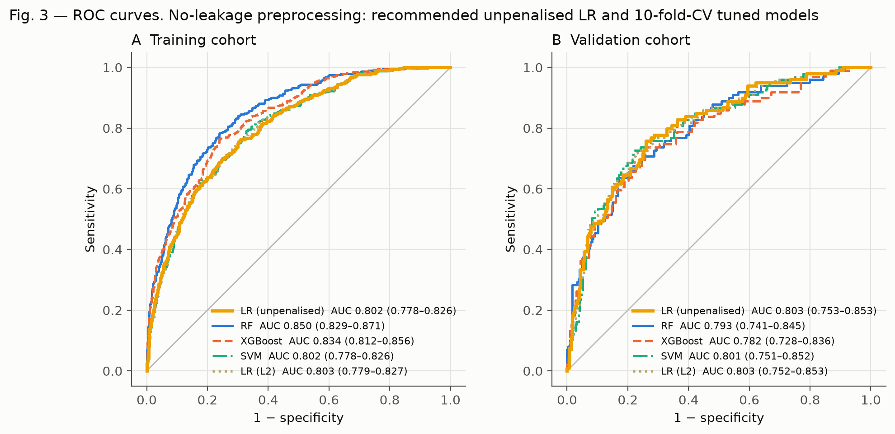

### A.2 Pairwise model comparison (paired DeLong test, Holm correction) ([`tables/delong_pairwise.csv`](tables/delong_pairwise.csv))

| params | Comparison | auc_1 | auc_2 | ΔAUC (95% CI) | z | p | p (Holm) |
|---|---|---|---|---|---|---|---|
| recommended | LR (unpenalised) vs RF (paper) | 0.803 | 0.780 | +0.022 (-0.002 to +0.047) | 1.820 | 0.069 | 0.344 |
| recommended | LR (unpenalised) vs RF (R defaults) (paper) | 0.803 | 0.756 | +0.046 (+0.005 to +0.088) | 2.203 | 0.028 | 0.193 |
| recommended | LR (unpenalised) vs XGBoost (paper) | 0.803 | 0.787 | +0.016 (-0.003 to +0.035) | 1.616 | 0.106 | 0.425 |
| recommended | LR (unpenalised) vs SVM (paper) | 0.803 | 0.763 | +0.040 (+0.004 to +0.075) | 2.189 | 0.029 | 0.193 |
| recommended | LR (unpenalised) vs RF (tuned) | 0.803 | 0.793 | +0.010 (-0.008 to +0.028) | 1.118 | 0.264 | 0.791 |
| recommended | LR (unpenalised) vs XGBoost (tuned) | 0.803 | 0.782 | +0.020 (+0.003 to +0.038) | 2.257 | 0.024 | 0.192 |
| recommended | LR (unpenalised) vs SVM (tuned) | 0.803 | 0.801 | +0.001 (-0.008 to +0.011) | 0.259 | 0.796 | 1.000 |
| recommended | LR (unpenalised) vs LR (L2) (tuned) | 0.803 | 0.803 | +0.000 (-0.006 to +0.006) | 0.044 | 0.965 | 1.000 |
| paper | RF vs RF (R defaults) | 0.780 | 0.756 | +0.024 (-0.014 to +0.062) | 1.231 | 0.218 | 0.956 |
| paper | RF vs XGBoost | 0.780 | 0.787 | -0.006 (-0.030 to +0.017) | -0.546 | 0.585 | 1.000 |
| paper | RF vs SVM | 0.780 | 0.763 | +0.017 (-0.017 to +0.051) | 0.971 | 0.332 | 0.995 |
| paper | RF (R defaults) vs XGBoost | 0.756 | 0.787 | -0.030 (-0.071 to +0.011) | -1.452 | 0.146 | 0.879 |
| paper | RF (R defaults) vs SVM | 0.756 | 0.763 | -0.007 (-0.053 to +0.040) | -0.290 | 0.772 | 1.000 |
| paper | XGBoost vs SVM | 0.787 | 0.763 | +0.024 (-0.012 to +0.059) | 1.307 | 0.191 | 0.956 |
| tuned | RF vs XGBoost | 0.793 | 0.782 | +0.010 (-0.004 to +0.024) | 1.437 | 0.151 | 0.603 |
| tuned | RF vs SVM | 0.793 | 0.801 | -0.009 (-0.025 to +0.008) | -1.039 | 0.299 | 0.625 |
| tuned | RF vs LR (L2) | 0.793 | 0.803 | -0.010 (-0.025 to +0.006) | -1.258 | 0.208 | 0.625 |
| tuned | XGBoost vs SVM | 0.782 | 0.801 | -0.019 (-0.037 to -0.001) | -2.119 | 0.034 | 0.171 |
| tuned | XGBoost vs LR (L2) | 0.782 | 0.803 | -0.020 (-0.038 to -0.003) | -2.303 | 0.021 | 0.128 |
| tuned | SVM vs LR (L2) | 0.801 | 0.803 | -0.001 (-0.008 to +0.006) | -0.331 | 0.741 | 0.741 |

### A.3 Thresholds and classification metrics ([`tables/youden_thresholds.csv`](tables/youden_thresholds.csv), [`tables/threshold_metrics.csv`](tables/threshold_metrics.csv))

Thresholds (stage 4, Youden thresholds of non-nested 10-fold OOF predictions, D4.13):

| params | model | threshold_oof | youden_j_train_oof | threshold_apparent | youden_j_train_apparent |
|---|---|---|---|---|---|
| recommended | LR (unpenalised) | 0.259 | 0.437 | 0.231 | 0.453 |
| paper | RF | 0.245 | 0.433 | 0.251 | 0.600 |
| paper | RF (R defaults) | 0.333 | 0.371 | 0.556 | 0.978 |
| paper | XGBoost | 0.251 | 0.460 | 0.243 | 0.521 |
| paper | SVM | 0.218 | 0.382 | 0.184 | 0.648 |
| tuned | RF | 0.257 | 0.463 | 0.281 | 0.544 |
| tuned | XGBoost | 0.243 | 0.470 | 0.273 | 0.525 |
| tuned | SVM | 0.244 | 0.449 | 0.248 | 0.462 |
| tuned | LR (L2) | 0.228 | 0.446 | 0.267 | 0.456 |

Validation metrics at the Youden threshold:

| params | model | threshold | accuracy | precision | recall | f1 | specificity | flagged_pct |
|---|---|---|---|---|---|---|---|---|
| recommended | LR (unpenalised) | 0.259 | 0.740 | 0.490 | 0.737 | 0.589 | 0.741 | 0.380 |
| paper | RF | 0.245 | 0.691 | 0.434 | 0.737 | 0.547 | 0.676 | 0.429 |
| paper | RF (R defaults) | 0.333 | 0.686 | 0.426 | 0.697 | 0.529 | 0.683 | 0.413 |
| paper | XGBoost | 0.251 | 0.719 | 0.465 | 0.737 | 0.570 | 0.713 | 0.401 |
| paper | SVM | 0.218 | 0.753 | 0.507 | 0.697 | 0.587 | 0.771 | 0.347 |
| tuned | RF | 0.257 | 0.699 | 0.442 | 0.737 | 0.553 | 0.686 | 0.421 |
| tuned | XGBoost | 0.243 | 0.717 | 0.462 | 0.737 | 0.568 | 0.710 | 0.403 |
| tuned | SVM | 0.244 | 0.686 | 0.431 | 0.758 | 0.549 | 0.662 | 0.444 |
| tuned | LR (L2) | 0.228 | 0.696 | 0.442 | 0.768 | 0.561 | 0.672 | 0.439 |

Validation metrics at threshold 0.5 (comparison):

| params | model | accuracy | precision | recall | f1 | specificity | flagged_pct |
|---|---|---|---|---|---|---|---|
| recommended | LR (unpenalised) | 0.809 | 0.688 | 0.444 | 0.540 | 0.932 | 0.163 |
| paper | RF | 0.798 | 0.679 | 0.384 | 0.490 | 0.939 | 0.143 |
| paper | RF (R defaults) | 0.763 | 0.537 | 0.444 | 0.486 | 0.870 | 0.209 |
| paper | XGBoost | 0.796 | 0.634 | 0.455 | 0.529 | 0.911 | 0.181 |
| paper | SVM | 0.793 | 0.705 | 0.313 | 0.434 | 0.956 | 0.112 |
| tuned | RF | 0.768 | 0.722 | 0.131 | 0.222 | 0.983 | 0.046 |
| tuned | XGBoost | 0.793 | 0.629 | 0.444 | 0.521 | 0.911 | 0.179 |
| tuned | SVM | 0.809 | 0.658 | 0.505 | 0.571 | 0.911 | 0.194 |
| tuned | LR (L2) | 0.801 | 0.698 | 0.374 | 0.487 | 0.945 | 0.135 |

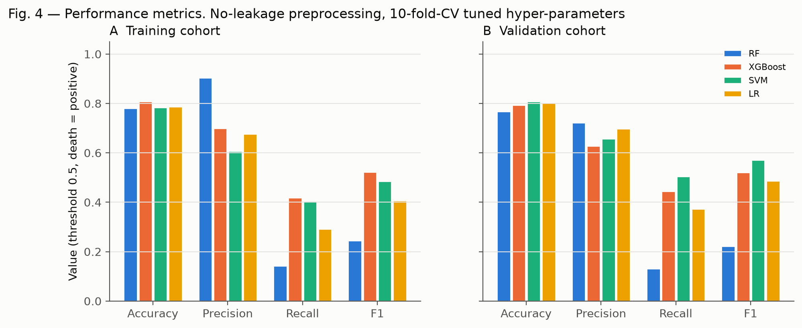

### A.4 Calibration ([`tables/calibration.csv`](tables/calibration.csv), [`tables/lr_variants.csv`](tables/lr_variants.csv))

| params | model | brier | scaled_brier | cal_in_the_large | cal_slope | mean_pred | observed |
|---|---|---|---|---|---|---|---|
| recommended | LR (unpenalised) | 0.145 | 0.234 | -0.054 | 0.965 | 0.260 | 0.253 |
| paper | RF | 0.150 | 0.207 | -0.012 | 0.916 | 0.254 | 0.253 |
| paper | RF (R defaults) | 0.162 | 0.140 | -0.151 | 0.170 | 0.273 | 0.253 |
| paper | XGBoost | 0.147 | 0.221 | -0.034 | 0.879 | 0.257 | 0.253 |
| paper | SVM | 0.153 | 0.191 | -0.035 | 1.268 | 0.258 | 0.253 |
| tuned | RF | 0.153 | 0.192 | -0.013 | 1.764 | 0.255 | 0.253 |
| tuned | XGBoost | 0.148 | 0.216 | -0.023 | 0.877 | 0.256 | 0.253 |
| tuned | SVM | 0.146 | 0.225 | -0.276 | 0.986 | 0.294 | 0.253 |
| tuned | LR (L2) | 0.145 | 0.234 | -0.048 | 1.206 | 0.260 | 0.253 |

| LR variant | Training OOF AUC | OOF Brier | OOF calibration slope | Validation AUC | Validation Brier | Validation calibration intercept | Validation calibration slope |
|---|---|---|---|---|---|---|---|
| Unpenalised (recommended) | 0.792 | 0.149 | 0.93 | 0.803 | 0.145 | -0.054 | 0.96 |
| L2, C = 0.01 (comparison) | 0.796 | 0.149 | 1.20 | 0.803 | 0.145 | -0.048 | 1.21 |

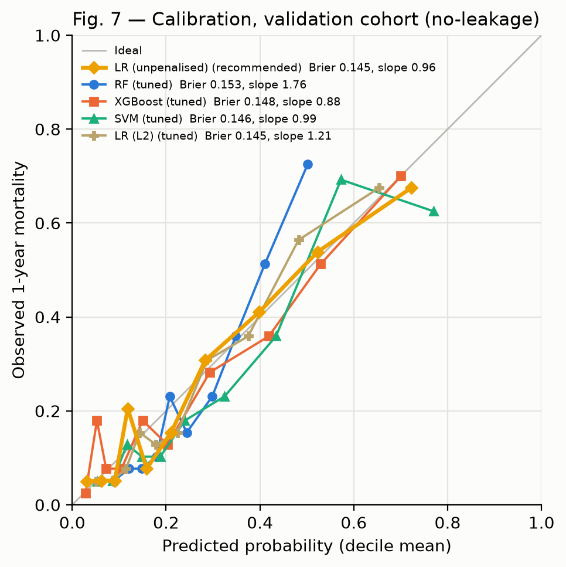

### A.5 "LASSO-only nested" CV (stage 7, D4.18) ([`tables/nested_cv_auc.csv`](tables/nested_cv_auc.csv), [`tables/nested_cv_folds.csv`](tables/nested_cv_folds.csv))

The outer loop uses the same 10 folds as stage 4 (seed 42); imputation, standardisation and LASSO are redone inside each fold, with hyperparameters fixed at the stage-4 values, isolating only the variable-selection bias. Superseded by the full nested CV (Section 6.1).

| params | Model | Original CV AUC (LASSO outside CV) | Nested CV AUC (LASSO within each fold) | Optimism (original − nested) | Per-fold optimism range |
|---|---|---|---|---|---|
| recommended | LR (unpenalised) | 0.793 | 0.781 | +0.011 | +0.000 to +0.023 |
| paper | RF | 0.775 | 0.765 | +0.011 | -0.020 to +0.050 |
| paper | RF (R defaults) | 0.736 | 0.705 | +0.030 | -0.001 to +0.075 |
| paper | XGBoost | 0.797 | 0.789 | +0.008 | -0.007 to +0.041 |
| paper | SVM | 0.720 | 0.711 | +0.009 | -0.019 to +0.057 |
| tuned | RF | 0.800 | 0.785 | +0.015 | -0.000 to +0.035 |
| tuned | XGBoost | 0.800 | 0.789 | +0.011 | -0.001 to +0.032 |
| tuned | SVM | 0.793 | 0.783 | +0.010 | -0.002 to +0.024 |
| tuned | LR (L2) | 0.796 | 0.784 | +0.013 | -0.000 to +0.026 |

## Appendix B: file list

- **Definition C cohort and features**: `tables/cohort_flow.csv`, `outcome_definitions.csv`, `outcome_check.csv`, `cbc_missingness.csv`, `dn_codes.csv`, `itemid_audit_*.csv`, `feature_vs_paper.csv`, `unit_mixing_diagnostic.csv`, `hypertension_definitions.csv`, `table1.csv`, `table1_after_imputation.csv`, `missingness.csv`
- **Definition C, stages 4–7**: `tables/lasso_*.csv`, `model_performance.csv`, `tuned_hyperparameters.json`, `calibration.csv`, `overfitting.csv`, `youden_thresholds.csv`, `threshold_metrics.csv`, `delong_pairwise.csv`, `lr_variants.csv`, `lr_coefficients.csv`, `shap_importance*.csv`, `dca_*.csv`, `cic_*.csv`, `nested_cv_*.csv`, `sensitivity_pre2020.csv`
- **Definition C, stage 8** (`replication/`): `nested_cv_full_*_C.csv` (full nested CV), `holdout_C.csv`, `holdout_dca_C.csv` (secondary held-out estimate), `comorb_time_*_C.csv`, `nested_cv_full_*_C_comorb_time.csv` (comorbidity-timing sensitivity analysis)
- **CLIN** (`clinical/`): `cohort_flow_clin.csv`, `split_clin_summary.csv`, `comorb_clin_*.csv`, `wbc_diff_patterns_clin.csv`, `missingness_clin.csv`, `table1_clin.csv`, `wbc_diff_missing_mortality_clin.csv`, `obesity_source_clin.csv`, `nested_cv_full_*_clin.csv`, `frozen_model_clin.json`, `final_model_clin.json`, `holdout_clin.csv`, `holdout_dca_clin.csv`, `holdout_gap_diagnostics_clin.csv`, `coefs_clin.csv`, `shap_clin.csv`, `nested_cv_full_*_clin_{prior_only,no_wbc_diff}.csv`
- **Figures**: `figures/fig2a–fig8_*.png` (definition C; names with `primary` use the unpenalised LR as the main model, names with `secondary` the tuned RF); `figures/figC1–C4_*.png` (CLIN). Single-patient force plots `fig6c–e` are kept on the local machine only

> Paths in this part refer to the original extension project layout; in this repository the code is under extensions/.

<!-- BEGIN BALANCED EXTENSION SOURCES -->
## Appendix C: Extension result sources and reproduction

- Aggregate snapshot: `extensions/balanced_27464ba98305edbc/`; source experiment: `dn_mortality_repro_V3_extensions/balanced/results/full/27464ba98305edbc`.
- Main performance, paired folds and complete OOF summaries: [summary.csv](extensions/balanced_27464ba98305edbc/summary.csv), [fold_metrics.csv](extensions/balanced_27464ba98305edbc/fold_metrics.csv), [paired_comparisons.csv](extensions/balanced_27464ba98305edbc/paired_comparisons.csv), [pooled_oof_metrics.csv](extensions/balanced_27464ba98305edbc/pooled_oof_metrics.csv).
- Supporting evidence: [extension_evidence.json](extensions/balanced_27464ba98305edbc/extension_evidence.json), [temporal_selection_frequency.csv](extensions/balanced_27464ba98305edbc/temporal_selection_frequency.csv), [repeat_stability.csv](extensions/balanced_27464ba98305edbc/repeat_stability.csv), [pooled_dca.csv](extensions/balanced_27464ba98305edbc/pooled_dca.csv), [dca_comparison.csv](extensions/balanced_27464ba98305edbc/dca_comparison.csv).
- Run identity, cache reuse and SHA-256 provenance: [run_identity.json](extensions/balanced_27464ba98305edbc/run_identity.json), [cache_reuse.json](extensions/balanced_27464ba98305edbc/cache_reuse.json), [source_provenance.json](extensions/balanced_27464ba98305edbc/source_provenance.json). These are aggregate outputs without `subject_id`, `hadm_id`, `stay_id`, raw ICD documents or individual predicted probabilities.
- Code and Chinese experiment records: `balanced/dn_extensions/{features,modeling,evaluation}.py` and `balanced/notebooks/02–06` in the extension project. The supplement generator `scripts/report_extensions.py` in the original V3 project reads only this archived snapshot and is called by `scripts/05_report.py`, preserving the extension part when the Chinese report is regenerated.

Original command for the additional tree-model experiments (run from `dn_mortality_repro_V3_extensions`):

```bash
bash balanced/run_extensions.sh full --experiments temporal_rf,temporal_xgb,embedding_rf,embedding_xgb --reuse-from ebf3f368bb8beb5c
```

All original static/temporal/diagnosis/stacking experiments can be run separately by experiment name through the same entry point. Full parameters are recorded in the snapshot's `run_identity.json`. Reading the archived report does not require retraining; `python scripts/05_report.py`, run in the original V3 project, only regenerates the report summary. The command above reuses existing compatible caches; instructions for a fresh run without those caches are in [the sharing and dependency guide](SHARING_AND_DEPENDENCIES.md).
<!-- END BALANCED EXTENSION SOURCES -->
